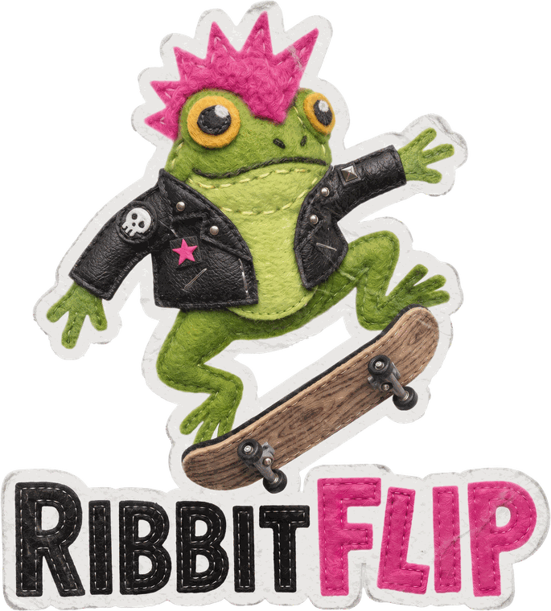
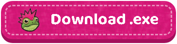
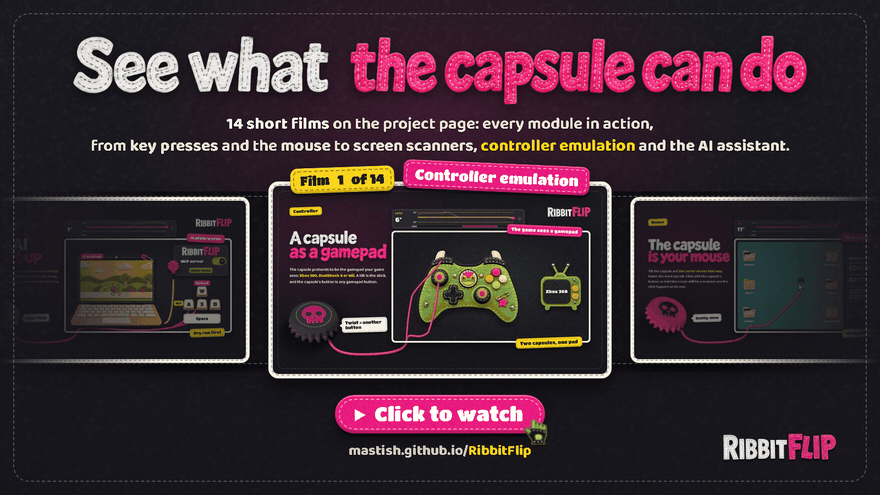
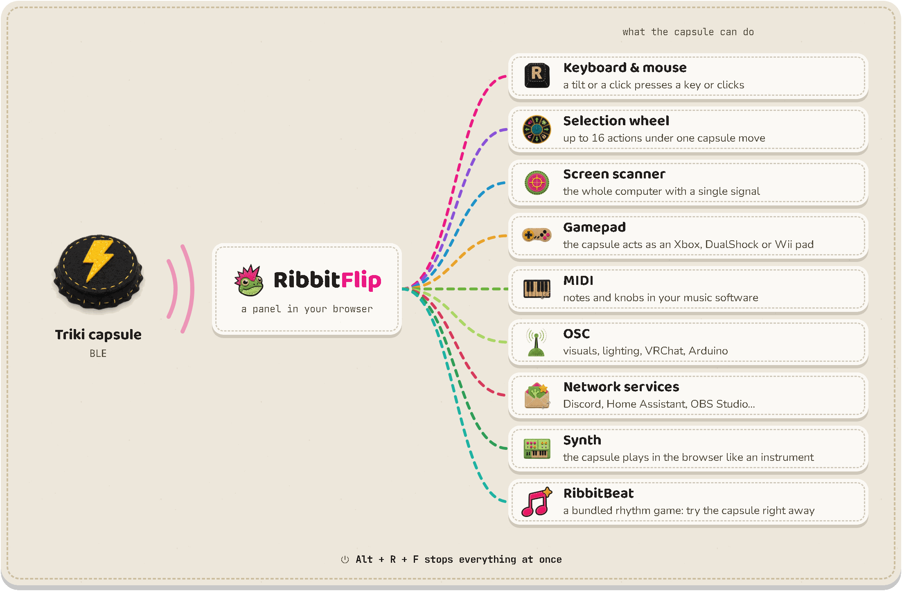
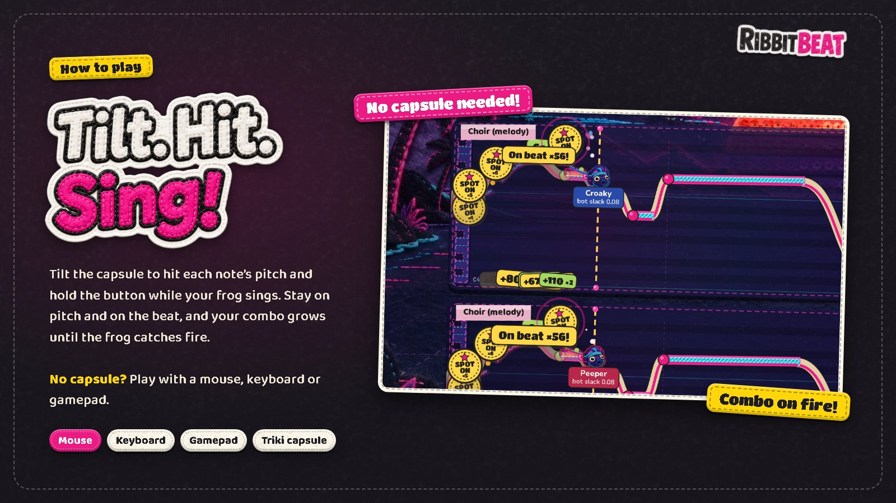

<p align="center">
  
</p>

<p align="center">
  <a href="https://mastish.github.io/RibbitFlip/"></a>
  <a href="https://discord.gg/tyv2MjjVdb"></a>
  <a href="../../releases"></a>
</p>

<p align="center">
  <a href="README.md"></a>
  <a href="README.en.md"></a>
</p>

<p align="center">
  <sub><i>This is the English translation. The project's main README is
  <a href="README.md">in Polish</a>; if the two ever disagree, that one is right.</i></sub>
</p>

<h1 align="center">RibbitFlip</h1>

<p align="center">
  <b>Turn the "Triki" capsule's motion into whatever you can think of.</b><br>
  The "Triki" capsule has a motion sensor and a button inside. RibbitFlip connects it to your computer,<br>
  and you decide what happens when you tilt, turn or click it: skip a track, jump in a game,<br>
  play a note, switch off a lamp. Everything runs on your own computer, with no cloud and no accounts.
</p>

<p align="center">
  Runs on Windows · free · works with the "Triki" capsule sold by Żabka.<br>
  Also built for people with motor disabilities: <a href="#accessibility-a-computer-with-one-signal">run a computer with one signal</a>.<br>
  Want to try it straight away? <a href="#try-it-right-away-ribbitbeat">Play RibbitBeat</a>, the rhythm game that comes with the project.
</p>

<p align="center">
  <a href="../../releases/latest"></a>
  
  
  
</p>

<p align="center"><a href="https://mastish.github.io/RibbitFlip/#jak"></a><br>
<sub><a href="https://mastish.github.io/RibbitFlip/#jak">▶ Click the card to watch 14 short films on the project page.</a></sub></p>

## Quick start

[Releases](../../releases) has three files:

- `RibbitFlip.exe`: the whole app; if you are not sure which one you want, it is this one.
- `RibbitFlip-Essential.exe`: the same app without the Synth and the game, for when the capsule only drives your computer.
- `RibbitBeat.exe`: just the rhythm game (preview), full screen straight away, to play with friends.
  Capsules join the game when RibbitFlip or RibbitFlip Essential runs on the same computer.

1. Download `RibbitFlip.exe` from [Releases](../../releases) and put it in a folder of its own.
2. Run it. The panel opens in your browser by itself.
3. Press the middle of the capsule and hold it close to the computer. No Windows pairing needed.
4. In the **Setups** tab, load a ready-made setup and switch its module on with **Off/On**.

No capsule? Switch the panel to **Simulation** and drive the capsule with your mouse. The full
guide, the SmartScreen window and troubleshooting: **[Getting started](docs/en/getting-started.md)**.

## How it works

<p align="center"></p>

The capsule keeps telling your computer how it is tilted, whether it is turning and whether
someone pressed the button. You set rules of the kind **"when the capsule does X, do Y"**, for
example: when I tilt the capsule to the right, skip to the next track. You set everything up in
the **panel**, which opens in your browser. The emergency stop `Alt`+`R`+`F` switches everything
off at once.

| Module | What it does |
|---|---|
| **Mapping** | Tilting, turning or clicking the capsule presses a key, clicks the mouse or presses a gamepad button. |
| **Selection wheel** | A wheel with up to 16 actions on screen; you pick one by moving the capsule. |
| **Mouse** | The capsule drives the cursor, and a click can happen by itself when you hold the cursor still. |
| **Scanner** | The whole computer with one signal: a bar sweeps the screen and you stop it where it should click. |
| **Controller** | The capsule acts as a gamepad: Xbox 360, DualShock 4 or Wii. |
| **MIDI** | The capsule's motion controls a music program: volume, a filter or notes. |
| **OSC** | The capsule's motion goes to visuals, lighting and stage software (TouchDesigner, Resolume, VRChat). |
| **Services** | The capsule's motion sends a command to Discord, Home Assistant, OBS Studio and more. |
| **Synth** | The capsule plays in the browser like an instrument. |
| **RibbitBeat** | A rhythm game: you sing a song's notes by tilting the capsule, alone or with friends. |

Several capsules at once, setups to share, overlays over your game and an AI assistant (MCP):
**[all features](docs/en/features.md)**.

**A slower computer?** Switch off the modules you do not use at start, in **Settings → Modules
switched off at start** or with an option such as `RibbitFlip.exe --disable wheel,overlay,synth,game`.
Details: **[A slower computer](docs/en/features.md#a-slower-computer-start-only-the-modules-you-need)**.

## Accessibility: a computer with one signal

RibbitFlip was also made for people who can't use a standard mouse or keyboard. **The screen
scanner** turns one reliable movement, say a nod or a button press, into control of the whole
computer. **Click without clicking** clicks when you hold the cursor still, and the capsule can be
clipped to a cap. It is the same technique as Switch Control on Apple and Switch Access on Android,
and the capsule costs very little, so it is a cheap test before anyone buys specialist equipment.
To be fair: this is a hobby project, not a medical device.
More: **[RibbitFlip as a helping hand](docs/en/helping-hand.md)**.

## Try it right away: RibbitBeat

<p align="center"><a href="https://mastish.github.io/RibbitFlip/#zagraj"></a><br>
<sub><a href="https://mastish.github.io/RibbitFlip/#zagraj">▶ RibbitBeat posters in motion: the carousel on the project page</a></sub></p>

**RibbitBeat** is the rhythm game that comes with the project and the quickest way to see the capsule
in action: tilt it to hit the pitch of each note and hold the button while your frog should sing. Up to
eight players at once, and without a capsule you can play with the mouse, the keyboard or a gamepad.
The game is a **preview** and a **demo game, made with the help of AI** (code and artwork directed by
the author of the project). In the panel, the **RibbitBeat** button in the **Try it out** group opens it.
The full description: **[RibbitBeat: the game that comes with the project](docs/en/ribbitbeat.md)**.

## Documentation

| You want to… | Read |
|---|---|
| install and run the app, fix a problem | [Getting started](docs/en/getting-started.md) |
| learn every module and setting | [What RibbitFlip can do](docs/en/features.md) |
| get to know RibbitBeat: rules, controls, songs, rewards | [RibbitBeat: the game that comes with the project](docs/en/ribbitbeat.md) |
| control the computer without a mouse or keyboard, or with one signal | [A helping hand](docs/en/helping-hand.md) |
| know what the app sends and how it is protected | [Safety & privacy](docs/en/privacy.md) |
| run from source, build the `.exe`, see how it is built | [For developers](docs/en/developers.md) |
| connect an AI assistant | [MCP](docs/MCP.md) |
| see what changed | [CHANGELOG](CHANGELOG.md) |
| contribute or report a vulnerability | [CONTRIBUTING](.github/CONTRIBUTING.md) · [SECURITY](.github/SECURITY.md) |

Every module also has an **About** tab in the panel with an illustrated guide.

## For developers

From source (Windows, Python 3.10 or newer):

```bash
pip install -r requirements.txt
python ribbitflip_monitor.py --simulate     # no hardware: synthetic motion, real output
python ribbitflip_monitor.py                # real capsule, full control
```

The panel opens on `http://127.0.0.1:8770/`. Command-line flags, building the `.exe` and how it
works inside: **[For developers](docs/en/developers.md)**.

```text
ribbitflip_monitor.py   the app: capsule connection, rules, outputs, local panel server
web/                    the browser panel (HTML, JS, CSS)
docs/                   documentation, project page, graphics
Presets/                setups bundled with the app
examples/               sample configuration files
tests/                  tests
tools/                  helper tools, releases, pre-publication review
build_exe.bat           builds dist/RibbitFlip.exe and dist/RibbitBeat.exe with a double-click (PyInstaller); full, essential, beat, all: one or all
RibbitFlip.spec         the PyInstaller recipe: what goes into the one-file .exe (full and Essential)
RibbitBeat.spec         the recipe for the game on its own; its entry point is ribbitbeat_app.py
```

## Community

Setups, help, ideas and clips: the **[Discord server](https://discord.gg/tyv2MjjVdb)**, forums
#zestawy (setups), #pomoc (help), #pochwal-się (show off) and #pomysły (ideas). The **"Report a
problem"** button in the panel footer prepares a report; nothing is sent automatically.
Reproducible bugs: [GitHub Issues](../../issues).

It is free and it stays free. If it helps you, you can
[buy me a coffee on Ko-fi](https://ko-fi.com/mastish) or pass it on to a friend.

## License

MIT, © 2026 Mastish. If you use or fork it, keep the copyright and attribution notice.
Dependencies and their licenses: [`third_party_licenses/`](third_party_licenses/README.md).
Community protocol reverse-engineering and credits: [`CREDITS.md`](docs/CREDITS.md).

## Disclaimer

- **Unofficial hobby project.** RibbitFlip works with the "Triki" capsule sold by Żabka, but
  Żabka does not make, endorse or sponsor it.
- **Names are descriptive only.** "Triki" and every other product, company, game, application
  and service name belong to their owners. They appear only to show what RibbitFlip works with
  and imply no affiliation or endorsement.
- **No warranty.** The app is provided as-is, for hobbyist and educational use (see
  [`LICENSE`](LICENSE)). It is not a medical device.
