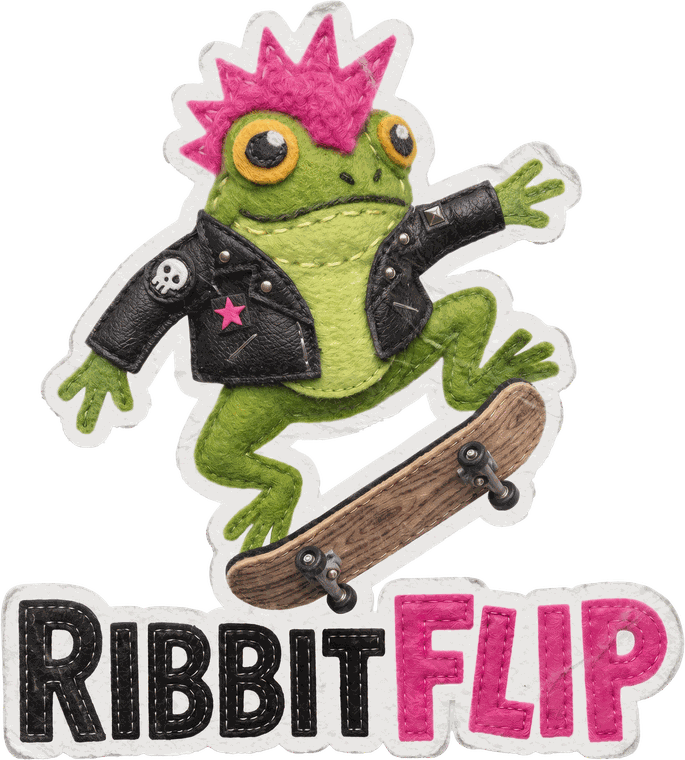
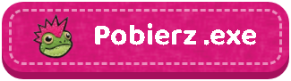
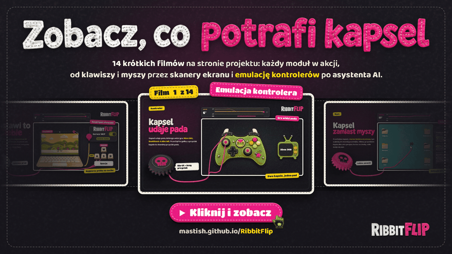
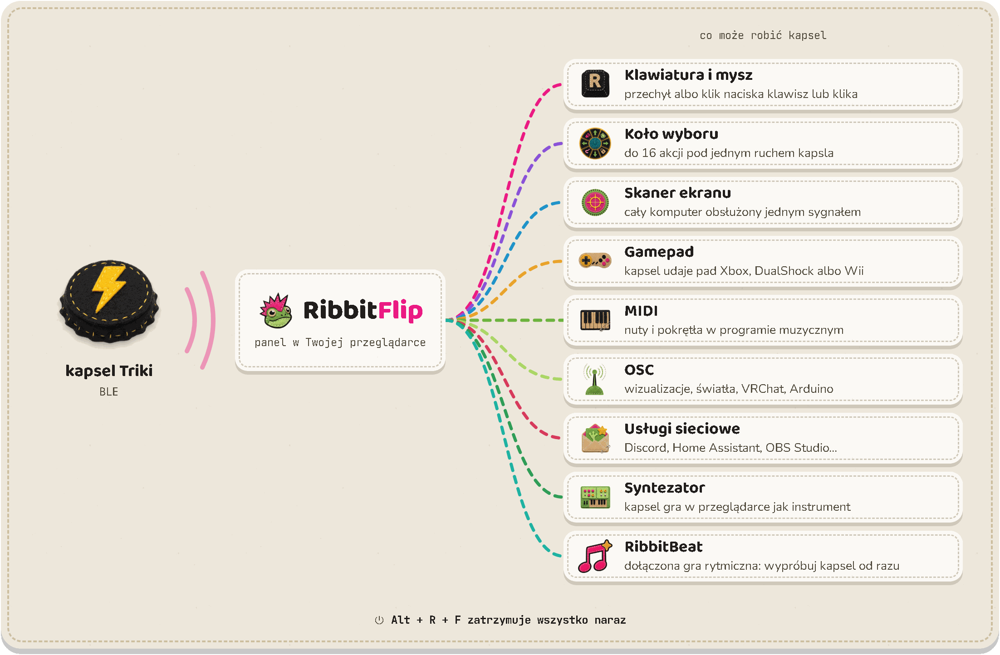
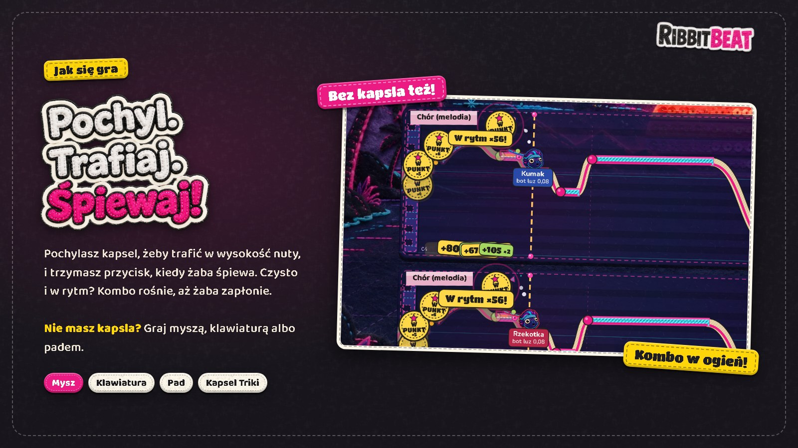

<p align="center">
  
</p>

<p align="center">
  <a href="https://mastish.github.io/RibbitFlip/"></a>
  <a href="https://discord.gg/tyv2MjjVdb"></a>
  <a href="../../releases"></a>
</p>

<p align="center">
  <a href="README.md"></a>
  <a href="README.en.md"></a>
</p>

<h1 align="center">RibbitFlip</h1>

<p align="center">
  <b>Zamień ruch kapsla „Triki" w co tylko wymyślisz.</b><br>
  Kapsel „Triki" ma w środku czujnik ruchu i przycisk. RibbitFlip łączy go z Twoim komputerem,<br>
  a Ty ustalasz, co ma się stać, gdy kapsel przechylisz, obrócisz albo klikniesz: przełączyć utwór,<br>
  skoczyć w grze, zagrać nutę, zgasić lampę. Wszystko dzieje się na Twoim komputerze, bez chmury i bez kont.
</p>

<p align="center">
  Działa na Windows · jest darmowy · potrzebuje kapsla „Triki" z Żabki.<br>
  Powstał także z myślą o osobach z niepełnosprawnością ruchową: <a href="#dostępność-komputer-jednym-sygnałem">komputer obsłużysz jednym sygnałem</a>.<br>
  Chcesz sprawdzić od razu? <a href="#przetestuj-od-razu-ribbitbeat">Zagraj w RibbitBeat</a>, grę rytmiczną dołączoną do projektu.
</p>

<p align="center">
  <a href="../../releases/latest"></a>
  
  
  
</p>

> [!NOTE]
> **Nieoficjalny projekt hobbystyczny, niezwiązany z Żabką.** RibbitFlip działa z kapslem „Triki",
> ale Żabka go nie tworzy, nie wspiera ani nie sponsoruje. Pełne zastrzeżenie jest
> [na końcu tego pliku](#zastrzeżenie).

<p align="center"><a href="https://mastish.github.io/RibbitFlip/#jak"></a><br>
<sub><a href="https://mastish.github.io/RibbitFlip/#jak">▶ Kliknij kartę i zobacz 14 krótkich filmów na stronie projektu.</a></sub></p>

## Szybki start

W [Releases](../../releases) są trzy pliki:

- `RibbitFlip.exe`: cała aplikacja; jeśli nie wiesz, który wybrać, to ten.
- `RibbitFlip-Essential.exe`: ta sama aplikacja bez Syntha i gry, gdy kapsel ma tylko sterować komputerem.
- `RibbitBeat.exe`: sama gra rytmiczna (wersja testowa), od razu na pełnym ekranie, do grania z przyjaciółmi.
  Kapsle dołączają do gry, gdy na tym samym komputerze działa RibbitFlip albo RibbitFlip Essential.

1. Pobierz `RibbitFlip.exe` z [Releases](../../releases) i włóż go do osobnego folderu.
2. Uruchom go. Panel otworzy się sam w przeglądarce.
3. Naciśnij środek kapsla i trzymaj go blisko komputera. Parowanie w Windows nie jest potrzebne.
4. W zakładce **Zestawy** wczytaj gotowy zestaw i włącz jego moduł przełącznikiem **Wył./Wł.**

Nie masz kapsla? Przełącz panel na **Symulację** i prowadź kapsel myszą. Pełna instrukcja,
okno SmartScreen i rozwiązywanie problemów: **[Pierwsze kroki](docs/pl/pierwsze-kroki.md)**.

## Jak to działa

<p align="center"></p>

Kapsel przez cały czas mówi komputerowi, jak jest przechylony, czy się obraca i czy ktoś nacisnął
przycisk. Ty ustalasz reguły w rodzaju **„gdy kapsel zrobi X, zrób Y"**, na przykład: gdy przechylę
kapsel w prawo, przełącz na następny utwór. Wszystko ustawiasz w **panelu**, który otwiera się
w przeglądarce. Stop awaryjny `Alt`+`R`+`F` wyłącza wszystko naraz.

| Moduł | Co robi |
|---|---|
| **Mapowanie** | Przechylenie, obrót albo kliknięcie kapsla naciska klawisz, klika myszą albo wciska przycisk pada. |
| **Koło wyboru** | Koło z maksymalnie 16 akcjami na ekranie, wybierasz jedną ruchem kapsla. |
| **Mysz** | Kapsel prowadzi kursor, a kliknięcie może zrobić się samo, gdy zatrzymasz kursor. |
| **Skaner** | Cały komputer jednym sygnałem: pasek jedzie przez ekran, a Ty zatrzymujesz go tam, gdzie ma kliknąć. |
| **Kontroler** | Kapsel udaje pad: Xbox 360, DualShock 4 albo Wii. |
| **MIDI** | Ruch kapsla steruje programem muzycznym: głośnością, filtrem albo nutami. |
| **OSC** | Ruch kapsla trafia do programów od wizualizacji, świateł i sceny (TouchDesigner, Resolume, VRChat). |
| **Usługi** | Ruch kapsla wysyła polecenie do Discorda, Home Assistanta, OBS Studio i innych. |
| **Synth** | Kapsel gra w przeglądarce jak instrument. |
| **RibbitBeat** | Gra rytmiczna: śpiewasz nuty piosenki, przechylając kapsel, sam albo ze znajomymi. |

Kilka kapsli naraz, gotowe zestawy do wymiany, nakładki nad grą i asystent AI (MCP):
**[pełny opis funkcji](docs/pl/funkcje.md)**.

**Słabszy komputer?** Moduły, których nie używasz, wyłączysz przy starcie w **Ustawienia → Moduły
wyłączone przy starcie** albo parametrem, na przykład `RibbitFlip.exe --disable kolo,nakladka,synth,gra`.
Szczegóły: **[Słabszy komputer](docs/pl/funkcje.md#słabszy-komputer-uruchom-tylko-potrzebne-moduły)**.

## Dostępność: komputer jednym sygnałem

RibbitFlip powstał także z myślą o osobach, które nie mogą korzystać ze standardowej myszy
i klawiatury. **Skaner ekranu** zamienia jeden pewny ruch, na przykład skinienie głową albo
naciśnięcie przycisku, w obsługę całego komputera. **Klik bez klikania** robi kliknięcie, gdy
zatrzymasz kursor, a kapsel można przypiąć do czapki. To ta sama technika, co Switch Control
w Apple i Switch Access w Androidzie, a kapsel kosztuje kilkadziesiąt złotych, więc to tani test,
zanim ktoś kupi sprzęt specjalistyczny. Uczciwie: to projekt hobbystyczny, nie wyrób medyczny.
Więcej: **[RibbitFlip jako pomocna dłoń](docs/pl/pomocna-dlon.md)**.

## Przetestuj od razu: RibbitBeat

<p align="center"><a href="https://mastish.github.io/RibbitFlip/#zagraj"></a><br>
<sub><a href="https://mastish.github.io/RibbitFlip/#zagraj">▶ Plakaty RibbitBeat w ruchu: karuzela na stronie projektu</a></sub></p>

**RibbitBeat** to gra rytmiczna dołączona do projektu i najszybszy sposób, żeby zobaczyć kapsel w akcji:
przechylasz go, żeby trafić w wysokość nuty, i trzymasz przycisk, gdy Twoja żaba ma śpiewać. Do ośmiu
graczy naraz, a bez kapsla zagrasz myszą, klawiaturą albo padem. Gra jest w **wersji testowej**
i jest **grą demonstracyjną, stworzoną z pomocą AI** (kod i grafiki powstały pod kierunkiem autora
projektu). W panelu otwiera ją przycisk **RibbitBeat** w grupie **Wypróbuj**. Pełny opis:
**[RibbitBeat: gra dołączona do projektu](docs/pl/ribbitbeat.md)**.

## Dokumentacja

| Chcesz… | Przeczytaj |
|---|---|
| zainstalować i uruchomić aplikację, rozwiązać problem | [Pierwsze kroki](docs/pl/pierwsze-kroki.md) |
| poznać wszystkie moduły i ustawienia | [Co potrafi RibbitFlip](docs/pl/funkcje.md) |
| poznać grę RibbitBeat: zasady, sterowanie, utwory, nagrody | [RibbitBeat: gra dołączona do projektu](docs/pl/ribbitbeat.md) |
| sterować komputerem bez myszy i klawiatury albo jednym sygnałem | [Pomocna dłoń](docs/pl/pomocna-dlon.md) |
| wiedzieć, co aplikacja wysyła i jak jest zabezpieczona | [Bezpieczeństwo i prywatność](docs/pl/prywatnosc.md) |
| uruchomić ze źródeł, zbudować `.exe`, poznać budowę | [Dla programistów](docs/pl/programisci.md) |
| podłączyć asystenta AI | [MCP](docs/MCP.md) |
| sprawdzić, co się zmieniło | [CHANGELOG](CHANGELOG.md) |
| pomóc w rozwoju albo zgłosić lukę | [CONTRIBUTING](.github/CONTRIBUTING.md) · [SECURITY](.github/SECURITY.md) |

Każdy moduł ma też w panelu zakładkę **Informacje** z poradnikiem i rysunkami.

## Dla programistów

Ze źródeł (Windows, Python 3.10 lub nowszy):

```bash
pip install -r requirements.txt
python ribbitflip_monitor.py --simulate     # bez sprzętu: ruch udawany, wyjścia prawdziwe
python ribbitflip_monitor.py                # prawdziwy kapsel, pełne sterowanie
```

Panel otwiera się pod `http://127.0.0.1:8770/`. Flagi wiersza poleceń, budowa `.exe` i opis
wnętrza: **[Dla programistów](docs/pl/programisci.md)**.

```text
ribbitflip_monitor.py   aplikacja: połączenie z kapslem, reguły, wyjścia, lokalny serwer panelu
web/                    panel w przeglądarce (HTML, JS, CSS)
docs/                   dokumentacja, strona projektu, grafiki
Presets/                zestawy dołączone do programu
examples/               przykładowe pliki konfiguracji
tests/                  testy
tools/                  narzędzia pomocnicze, wydania, przegląd przed publikacją
build_exe.bat           buduje dist/RibbitFlip.exe i dist/RibbitBeat.exe jednym dwuklikiem (PyInstaller); full, essential, beat, all: pojedynczo albo wszystkie
RibbitFlip.spec         przepis PyInstallera: co trafia do jednoplikowego .exe (pełny i Essential)
RibbitBeat.spec         przepis samej gry; jej punkt wejścia to ribbitbeat_app.py
```

## Społeczność

Zestawy, pomoc, pomysły i nagrania: **[serwer Discord](https://discord.gg/tyv2MjjVdb)**, fora
#zestawy, #pomoc, #pochwal-się i #pomysły. Przycisk **„Zgłoś problem"** w stopce panelu
przygotuje zgłoszenie; nic nie jest wysyłane automatycznie. Powtarzalne błędy:
[GitHub Issues](../../issues).

Apka jest darmowa i taka zostanie. Jeśli Ci się przydaje, możesz
[postawić mi kawę na Ko-fi](https://ko-fi.com/mastish) albo polecić ją znajomym.

## Licencja

MIT, © 2026 Mastish. Jeśli używasz projektu albo go forkujesz, zachowaj notkę o prawach
autorskich i autorstwie. Zależności i ich licencje: [`third_party_licenses/`](third_party_licenses/README.md).
Odtworzenie protokołu przez społeczność i podziękowania: [`CREDITS.md`](docs/CREDITS.md).

## Zastrzeżenie

- **Nieoficjalny projekt hobbystyczny.** RibbitFlip działa z kapslem „Triki" z Żabki, ale Żabka
  go nie tworzy, nie wspiera ani nie sponsoruje.
- **Nazwy wyłącznie opisowo.** „Triki" i wszystkie inne nazwy produktów, firm, gier, programów
  i usług należą do swoich właścicieli. Padają tylko po to, żeby pokazać, z czym RibbitFlip
  współpracuje, i nie oznaczają żadnego powiązania ani wsparcia.
- **Bez gwarancji.** Aplikacja jest udostępniana „tak jak jest", do użytku hobbystycznego
  i edukacyjnego (patrz [`LICENSE`](LICENSE)). To nie jest wyrób medyczny.
