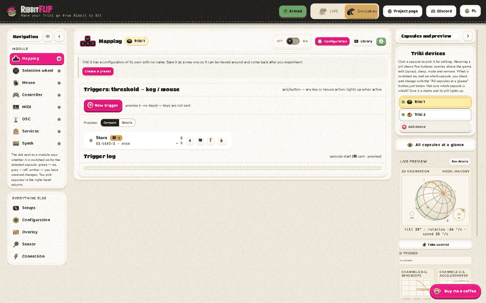

# Getting started

← [README](../../README.en.md) · [Polski](../pl/pierwsze-kroki.md)

## What you need

- **A Windows 10 or 11 computer (64-bit) with Bluetooth 4.0 or newer (Bluetooth LE).** Bluetooth has to be switched on.
- **A "Triki" capsule.** If you only want to try things out, you do not even need a capsule: the
  app has a simulation, a mode in which the capsule's motion is faked (see below).
- *Optional:* [**ViGEmBus**](https://github.com/nefarius/ViGEmBus/releases), a free driver that
  lets the capsule act as a gamepad (an Xbox 360 controller or a DualShock 4). You install it once.
- *Optional:* [**loopMIDI**](https://www.tobias-erichsen.de/software/loopmidi.html), a free program
  that lets the capsule control a music program on the same computer.

## Quick start

1. **Download the app.** Go to [Releases](https://github.com/Mastish/RibbitFlip/releases) and, under **Assets**, download
   `RibbitFlip.exe`. Move it into a folder of its own, because the app saves your settings next
   to it. Pick a folder you can write to (for example in Documents), not `Program Files`.
   Want to check that the file arrived unchanged? **Assets** also holds `SHA256SUMS.txt`, and the command
   `certutil -hashfile RibbitFlip.exe SHA256` in a command prompt shows the sum it has to match.
2. **Run it.** The first time, Windows shows a blue SmartScreen window, because the file has no
   digital signature. Click **"More info"**, then **"Run anyway"**. Why the window appears and
   whether it is safe is explained in the [FAQ on the project page](https://mastish.github.io/RibbitFlip/#faq).
3. **Find the panel.** The app has no ordinary window. It shows up as an icon next to the clock,
   in the so-called **system tray** (Windows 11 may hide it behind the `˄` arrow), and the panel
   opens by itself in your browser at `http://127.0.0.1:8770/`. That address only works on your
   own computer. The first time, the panel asks what you want to use RibbitFlip for. Pick a tile:
   the modules outside your choice wait under **More modules** at the bottom of the list and keep
   working. Then the panel offers a **Tour** that shows you in six steps where everything is.
4. **Connect the capsule.** The app starts looking for the first capsule straight away (the panel
   shows that it is searching). Press the middle of the capsule to wake it up and hold it close
   to the computer. You do not need to pair it in the Windows Bluetooth settings. Once it is
   connected, a coloured pill with the capsule's name appears in the panel. You add more capsules
   with the **Add a capsule** button in the right-hand column of the panel.
5. **Load a ready-made setup.** A **setup** is a saved set of settings. **Setups** is the first item in
   the navigation on the left, and it holds four badged **built-in** (their names are in Polish in the English interface too):
   - **Media - pokrętło głośności** (volume knob): the capsule lies flat and works like a volume
     knob, and a click is play/pause.
   - **Media - cztery strony** (four sides): tilting right and left changes the track, forward and
     back changes the volume.
   - **Pad na jeden kapsel (start)** (gamepad on one capsule): the capsule acts as an Xbox gamepad,
     tilting moves your character, and the capsule's button is A.
   - **Pad na dwa kapsle (start)** (gamepad on two capsules): two capsules make one gamepad, the
     left hand moves the character, the right one the camera.

   Both "Pad…" setups need the ViGEmBus driver.
6. **Switch the module on.** Loading a setup switches nothing on. The **Off/On** switch is in the
   header of the module's screen, for example **Mapping**, the screen with your rules (the "Pad…"
   setups also need the **Controller** module). The main **Armed** switch is already on, so from
   now on the capsule works.
7. **Remember the emergency stop: `Alt`+`R`+`F`.** It switches every module off at once, in case
   something goes wrong.

**No capsule?** The top bar of the panel has a **LIVE / Simulation** switch. When you switch to
simulation the app restarts by itself, and you steer the capsule by hand with the mouse (the
"Take control" button under the 3D preview ball). The motion is faked, but the keys and clicks are
real, which is why modules start switched off in simulation.

You quit the app from the tray icon's menu (**quit**).

## How to remove the app

RibbitFlip has no installer, so you remove it by hand:

1. If you ticked **"Run at Windows startup"** in the tray icon menu, untick it.
2. Close the app: tray icon menu, **"Quit"**.
3. Delete the folder with `RibbitFlip.exe`. Your settings (`Settings\`), library (`Library\`) and
   reports (`Zgloszenia\`) go with it.
4. Also delete the `%LOCALAPPDATA%\RibbitFlip` folder (type that address into the Explorer bar), if it exists.

## If something doesn't work

- **The panel did not open.** Type `http://127.0.0.1:8770/` into your browser, or choose "open the
  panel" from the tray icon's menu.
- **The icon is gone.** Windows 11 hides new icons behind the `˄` arrow next to the clock. You can
  drag it from there onto the taskbar.
- **The capsule will not connect.** Check that Bluetooth is on. If the capsule is connected to a
  phone, disconnect it there. Hold the capsule close to the computer and press its middle.
- **The capsule is connected, but nothing happens.** Check that the module is on, that the main
  switch is not set to **Paused**, and that the module has at least one rule.
- **The gamepad does not work in a game.** Install the [ViGEmBus](https://github.com/nefarius/ViGEmBus/releases) driver.
- **Your antivirus deletes the file.** It is a false alarm that happens to programs that press
  keys. What to do about it is in the [FAQ on the project page](https://mastish.github.io/RibbitFlip/#faq).

Still stuck? Post on Discord in the **#pomoc** (help) forum (the link to the server is under the
**Help and community** button in the panel's top bar). The **"Report a problem"** button in
the panel footer helps you prepare the report (more under [Community](../../README.en.md#community)).
