# RibbitBeat: the game that comes with the project

← [README](../../README.en.md) · [Polski](../pl/ribbitbeat.md)

RibbitBeat is the rhythm game built into RibbitFlip and the quickest way to see the "Triki" capsule in
action: nothing to set up, press the capsule's button and sing along with the frogs. The sticker in its
menu calls it the demo game of the project, and that is why it exists, but it plays like any game: up to
eight players, more than five hundred songs, rewards for playing and instruments of your own. It also works without a capsule, with
the mouse, the keyboard or a gamepad.

This page describes the game as it is today. RibbitBeat is a **preview** for now: the game works, but
its look and scoring may still change. Feedback is welcome on [Discord](https://discord.gg/tyv2MjjVdb).

To be upfront: RibbitBeat is a **demo game, made with the help of AI**. Its code and artwork were made
with the help of AI, directed by the author of the project, and its only job is to show what RibbitFlip
can do. In the game's menu the yellow **Made with AI** tag under the RibbitFlip sticker says so too: it
opens the **About the game** window.

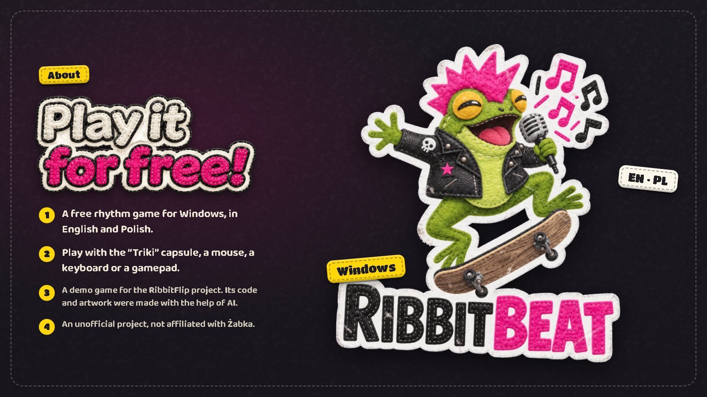

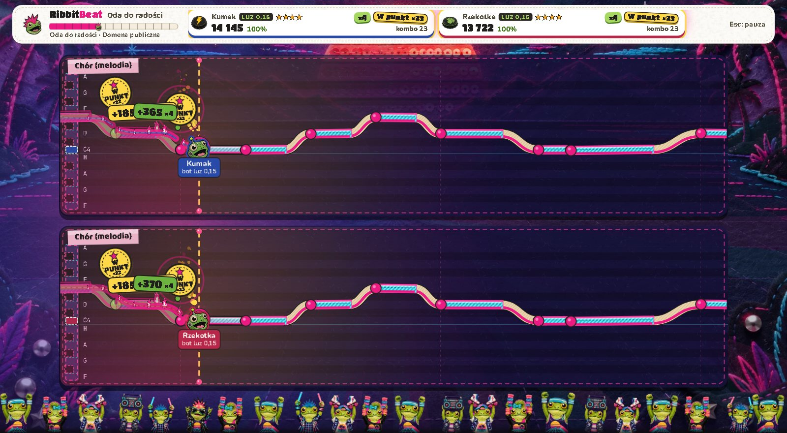

## How to start it

- **From the RibbitFlip panel.** In the navigation, under the Synth in the **Try it out** group, there is
  a **RibbitBeat** button. The game opens in a new browser tab, and capsules connected to the app join it
  with their button.
- **As a program of its own.** `RibbitBeat.exe` from [Releases](https://github.com/Mastish/RibbitFlip/releases)
  runs just the game, full screen straight away, with nothing to install. Mouse, keyboard and gamepad work
  right away; capsules join when RibbitFlip or RibbitFlip Essential runs on the same computer. Song packs
  downloaded in the app are in the game at once, and the other way round.
- **Without a capsule.** The mouse, W/S or the arrow keys and a gamepad are enough to play and to see the
  game before you buy a capsule.
- **Full screen** is the button in the top-right corner of the menu or `F11`. The **PL | EN** switch in the
  menu footer changes the language of the whole game; a language picked in the RibbitFlip panel carries over
  by itself.

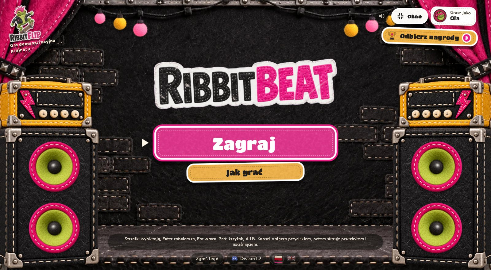

## How it plays

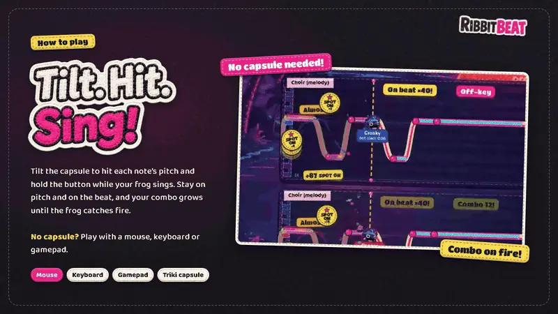

Every note of the song travels along the lane towards your frog. Tilt the capsule up and down to hit the
pitch of the note and hold the button while the frog should sing. A note has a head at its start (begin
singing) and a ring at its end (stop); a press in rhythm fills the head, and the note takes the colour of
your accuracy. Hits build the combo until the trail behind your frog, its head and the notes catch fire.

- **Spot on.** Press right at a note's start and release right at its end (within 100 ms) for a bonus that
  grows with every note in a row, a gold stamp and a counter in the HUD.
- **Glowing phrases.** Every song has 2 to 6 phrases; play all of a phrase's notes well for a 50% bonus,
  all of them clean for 75%.
- **Vibrato** on long notes works with every control: rock the capsule side to side, shake the mouse left
  and right, tap Q and E in turn (or . and /), or push the right pad stick.
- **Croak.** The button between notes croaks at the pitch of your tilt, just for fun: no points, no penalty.
- **Time to move.** On a wide leap the note ends a moment early so you can get there; a slider from 0 to 150%
  changes that slack and the points multiplier.
- **Two note modes.** *Classic*: every note on its own, with a jump between notes. *Smooth*: a longer note
  that runs into a neighbouring one slides to it along a curve, and you score along the whole slide.
- **Pause.** `Esc` stops the song; Resume counts 3, 2, 1, `R` starts the song again, `Q` quits.
- **How to play.** The button in the menu (and the first **Play**) runs a tutorial inside the real game: a bot
  sings and the game stops to explain the lane, the notes, vibrato, the HUD and the glowing phrases.

## Who plays

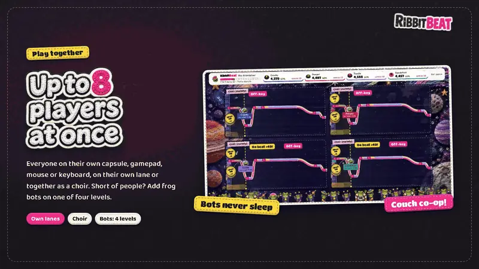

- **Up to eight players at once**, each on their own capsule, gamepad, mouse or keyboard. You set the
  line-up in step **2 Game**: **Add a player** picks the control, and every player has a name, a colour,
  a part, an instrument and a place in the **Line-up**. The line-up is remembered for the next game.
- **A capsule joins with its button** on any screen before the song and leads the menus at once: tilting
  moves the highlight, a short press picks, holding the button goes back. A capsule remembers its profile.
  In step **2 Game** the capsule sets up its own card: tilting forward and back picks a field (part, skin,
  instrument, assists, game level), tilting sideways changes it, the button says "ready", and holding goes
  back: from ready to the card settings, from not ready to the song list.
- **Bots.** Not enough people? Add frog bots on one of four levels, from Easy to Master. They stand next to
  the people on the results screen, but the leaderboard lists people only.
- **Lanes.** With several players each one gets their own lane (**Own lane**) or everyone sings on one
  (**Choir**); the screen layout (rows, columns, grid) is picked for you or by hand.
- **Parts.** Every song has parts with a difficulty rating from 1 to 10 and a preview. Before the song the
  keyboard and the gamepad set up the player's card the same way a capsule does: W/S, the up and down arrows or
  the D-pad pick a field (part, skin, instrument, assists, game level), A/D, the left and right arrows or the
  D-pad sideways change it, and Space, Enter or A says "ready".

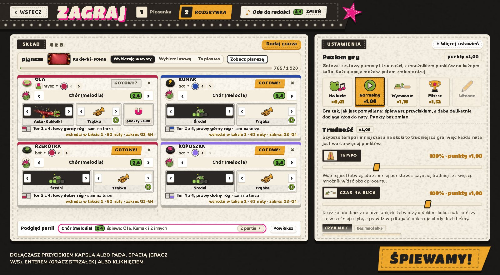

## Settings, levels and assists

The settings sit in described groups: **Game level**, **Difficulty**, **Assists**, **Controls**, **Screen
and lanes**, **Sound**, **Graphics**. The ready-made sets **Relaxed**, **Normal**, **Challenge** and
**Master** set the assists, time to move and tempo in one click; your own mix is kept as **Custom**.

Every assist shows its points multiplier and lowers the points by about as much as it helps, so it gives no
edge on the leaderboard; the percentage and the stars always count from singing alone. **Pull to notes** has
five levels, from Off to "From afar"; there is also a frog that sings on its own, jump to note on the
keyboard and a quiet melody hint. The **Assists** tile on a player card gives each player their own assists,
remembered in their profile.

A slower computer: **Graphics** *Simplified* instead of *Full*, and when frames cannot keep up the game lowers
the graphics one step by itself and remembers it. Stage effects are drawn by the graphics card (WebGL2);
without it the game keeps its classic look.

## Songs

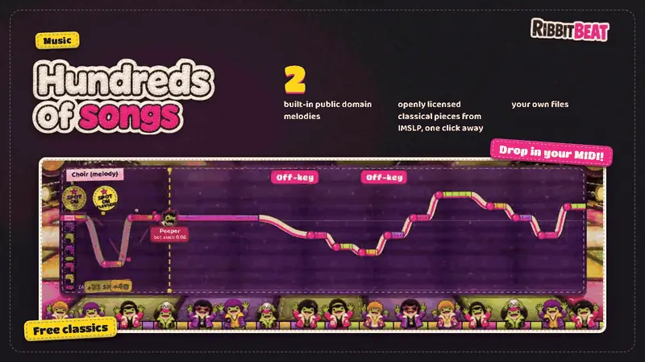

The library lives in **Play**, step **1 Song**: the song list on the left (tabs **All**, **Built-in**,
**Mine**, sorting, a search box, a heart pins favourites) and the chosen song on the right with its part
preview, difficulty and leaderboard. **Song settings** slide in from the right edge: the part to sing, the
backing, a section to practise, repeats and tempo. The song buttons (favourite, listen, settings, leaderboard)
show in the chosen row or under the pointer. With a capsule: tilting forward and back picks a song, and
holding the tilt scrolls the list in jumps, with a letter and the place in the list in the middle; tilting
sideways walks the song's buttons.

The step looks like a stage, not a form: the felt stage from the menu sits in the background, songs are patches
with a coloured difficulty spine, and the chosen song is a large light label. One row of dividers sits above the
list: the song source, a magnifier (the search box opens when clicked), a sort button and the pink **Add your
own** divider. On the right hangs the poster of the chosen song with a difficulty stamp, and the control hints and
the **Next** button lie on the edge of the stage.
The list works like a jukebox wheel: the chosen song always sits in the middle, and the patches get smaller and
paler the further they are from it. The wheel snaps one row at a time with a tick, also with the mouse wheel
(one notch is one song) and after clicking a row, and the poster on the right changes only once the wheel has
stopped. On the left, next to the chosen song, there is a large letter with smaller letters of the alphabet
above and below it; clicking a letter moves the wheel to its first song (the letters show when the list is
sorted alphabetically). The sort button also has **Easiest first**: the list then runs from the simplest melody
to the hardest, and difficulty steps stand in place of the letters. The number on a patch is the difficulty of
the melody; when a song has several parts, the range of all parts is shown under it, for example **3.1–8.1**,
and the poster carries a **Parts 3.1–8.1** tag. The six difficulty bars of a part are rows of water lilies:
a full lily is a point, a faded one is none. In the preview on the poster, the pulsing part button shows with
dots how many tracks the song has (each in its own colour, the current one larger); the arrows on either side
of it switch the part without opening the list. The arrows in the bottom row, next to the instrument name,
change the instrument the frog sings the preview with (the same **New player's instrument**
as in the settings). A second pair of arrows, with a **MIDI** tag, changes the **MIDI engine**, the character of
the backing: **Single instrument** plays everything with the chosen backing instrument (as before), **As in the
file** gives each track the sound closest to the instrument written in the MIDI file (violins play as strings,
a bass as a bass and so on; the built-in songs carry no such information and use the usual backing instrument),
while the **Band**, **Orchestra**, **Brass band**, **8-bit console**, **Music box** and **Synths** sets give the
bass, the middle and the top a sound of their own. Every engine except **Single instrument** also plays the
drums when the file has them. The same choice sits in the sound settings of step **2 Gameplay** and
works in the game itself too. Step **2 Gameplay**
stands on the same stage: the player cards and settings hang in front of it, and the start button lies on the
edge of the stage.

The **Add your own** divider opens a shelf of packs (record sleeves with the song count and a download button)
and a slot for your own files. The slot takes one file or many at once, and **Pick a whole folder** loads every
MIDI file in a folder and its subfolders. You can also drop a folder on the game window. After an import one
message says how many songs were added, how many were already in the library and how many could not be read.

- **19 built-in melodies** in the public domain, from "Ode to Joy" to "The Entertainer".
- **Your own MIDI files**: with a click (one or many at once), as a whole folder, by dropping files or a folder
  on the window, from an address
  or with Ctrl+V. The bin removes your own song from the library; its scores come back when you add the same
  file again.
- **Song packs** from IMSLP: three packs of classical music, about 530 pieces under CC0, CC BY and CC BY-SA,
  downloaded in one click from Hugging Face with a progress bar. RibbitFlip hosts no music; every song shows
  its composer, MIDI author, licence and source.
- Files with tempo changes play at their real speed, and an empty, damaged or drums-only file gets a clear
  message instead of an error.

## Results and the leaderboard

After the song, the results card breaks every player's score down: notes Clean, Good, Almost, Off-key and
Missed, vibratos, in-rhythm presses, "Spot on" and phrase bonuses; the stars stamp in one by one. **Copy
score** gives you one line to paste, and **Show it off on Discord** opens the server's channel.

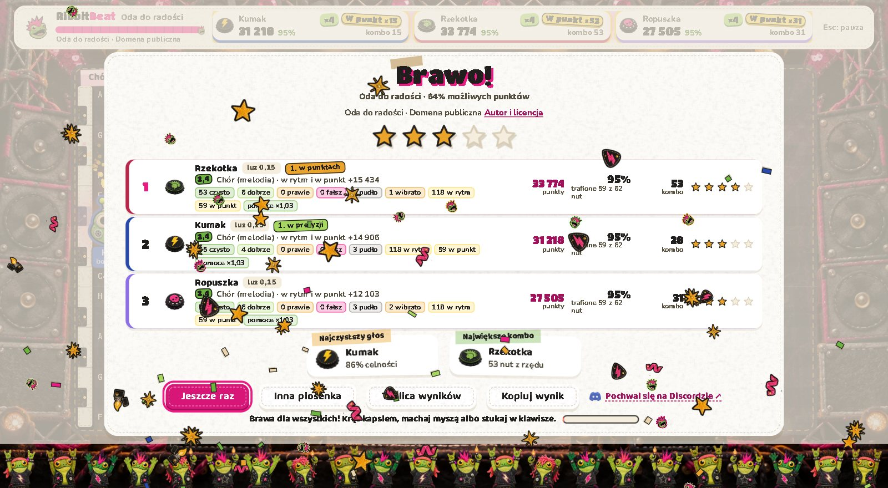

The leaderboard recognises a MIDI file by its content (a SHA-256 fingerprint), so the same file under another
name shares its scores, and every part, note mode and time to move is a competition of its own.

## Rewards: fame, the wheel and the crew

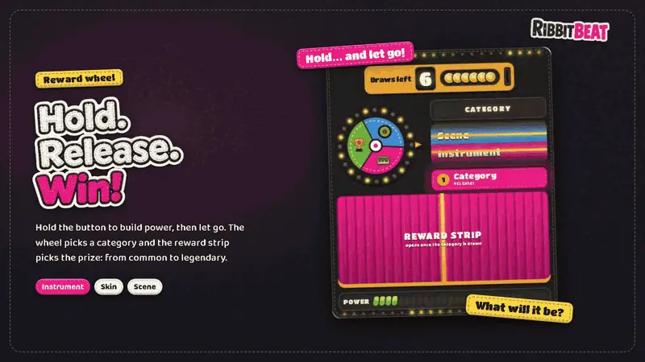

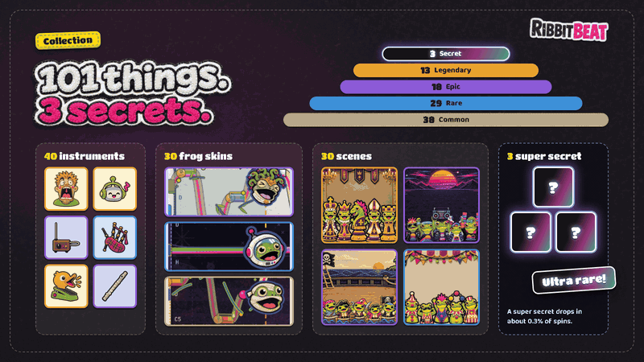

Every player earns **fame** for songs, combos, new songs and precision; the first song of the day counts
double. The whole **crew**, everyone who plays on this computer, collects rewards together: one shared level,
one wheel and the same unlocked items for everyone. With several players the shared pool gets the average
fame times a multiplier (×1.25 for two, ×1.4 for three, ×1.5 from four).

- **The reward wheel.** Every level is a draw: a bottle cap drops into the machine, lever 1 picks the
  category (instrument, skin or scene), lever 2 picks the item. Rarities run from common to legendary, and
  a black holographic **Secret card** has a tiny chance on every spin and never uses up a draw. With several
  players everyone holds their own button, and the wheel spins when the first one lets go. The full set takes
  about 3 to 5 hours of play; **Claim rewards** in the menu waits when draws are left over from the last song.
- **41 instruments**, each with its own felt icon and its own short tune when won: from the trumpet, the
  choir and the piano to the saxophone, bagpipes, theremin and the legendary **Scream**. A new crew starts
  with Ribbit.
- **31 themes**, that is boards (backdrop, crowd and keys as one): from felt through 8-bit, Halloween,
  pirates, disco and Tiki Island to sushi, chess, gold, Olympus, a real pond and a puppet theatre. Each has
  its own crowd, sparks, frog skin and end-of-song jingle; the skin and the scene of one theme are won
  separately.
- **The board before the song.** The **Board** bar in the Game step says who picks it: **Everyone picks**
  (a window with tiles and the pickers' avatars; different votes end in a draw), **Draw a random one** or
  **This board**.
- **53 achievements** give fame and shortcuts to themes. Progress counters and the date earned are under
  **Skin and achievements**, from the account badge in the menu or in the **Profiles** window.
- **The Instrument studio.** Once you have won every instrument (or drawn the Secret card), the menu gets
  its own screen for building instruments: your own wave, oscillators, filter, equaliser, envelope,
  an oscilloscope lamp, a test loop on a 16-step grid and a **Sample** card: record with the microphone or load
  a sound from disk, and the instrument sings your recording across the keyboard. Instruments save to a file
  and load on another computer.

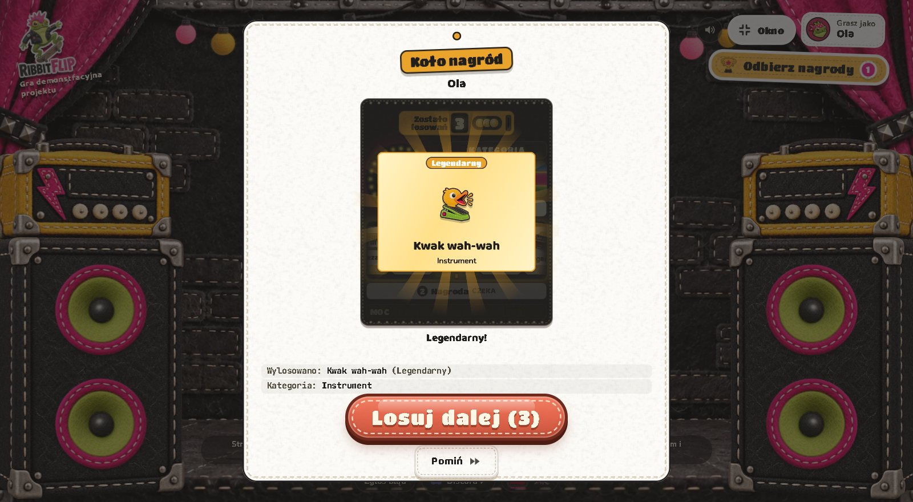

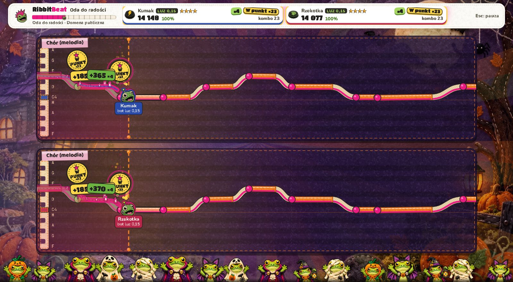

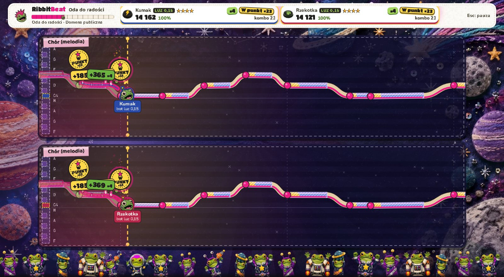

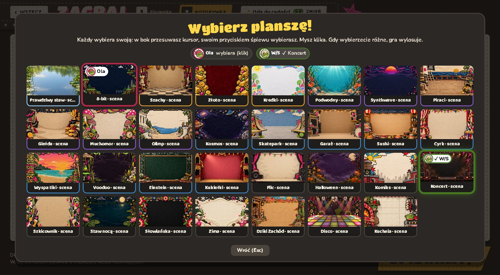

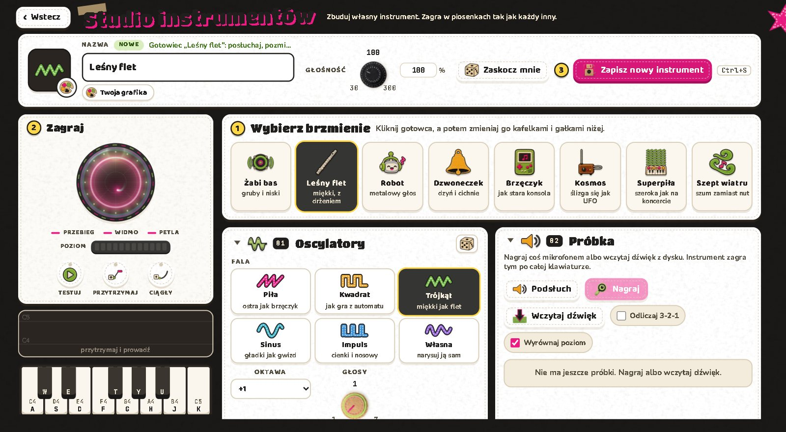

## Accounts and profiles

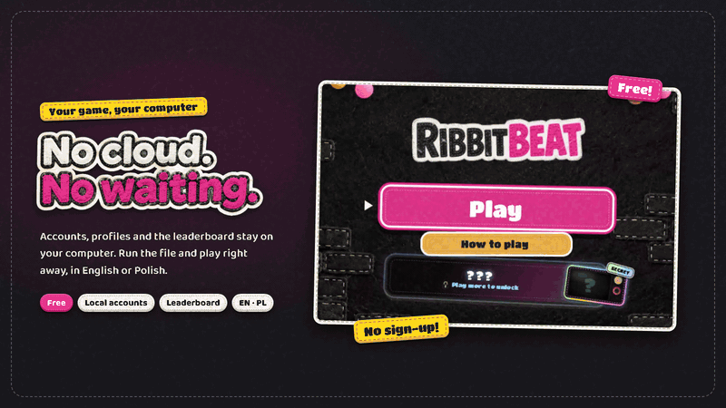

The **Who's playing on this computer?** screen creates an account (name, favourite colour and one of ten
felt punk frog avatars) or lets you in as a guest; settings are remembered per account. The **Playing as**
badge in the corner of the menu opens your account and the **Profiles** window, where everyone who played
here can be looked at (fame, themes, achievements, games), renamed, pinned, reset, deleted, exported and
imported on another computer. The leaderboard, your own songs and favourites stay in the browser.

## Controls

| | In the menus and before the song | In the game |
|---|---|---|
| **Capsule** | tilting moves the highlight, a press picks, holding goes back | tilt is the pitch, the button sings, rocking side to side is vibrato |
| **Mouse** | click | move up and down, the button sings, left and right is vibrato |
| **Keyboard** | arrows choose, Enter confirms, Esc goes back | W/S or the arrow keys, Space sings, Q and E (or . and /) vibrato, Shift for precise movement, `R` restarts, `Esc` pauses, `F11` full screen |
| **Gamepad** | D-pad chooses, A confirms, B goes back, Start pauses, Back closes windows | the stick is the pitch, the button sings, the right stick is vibrato |

## What else

- **The menu** is a felt concert stage with speakers and lamps that move to Dub Riot, an original punk-dub
  track; the speaker button in the corner mutes it. Menu sounds have their own switch and volume in the
  settings.
- **Discord**: a link in the menu and on the results screen leads to the project's server.
- **The whole game in English**: menus, themes, achievements, built-in songs and messages.
- **Privacy**: the game runs locally, and the microphone switches on only when you record a sample in the
  Studio; details in [Safety & privacy](privacy.md).

How the game sits inside the app (the `gra` module, switching it off at start, the panel) is in
[What RibbitFlip can do](features.md). What changed from version to version: [CHANGELOG](../../CHANGELOG.md).
