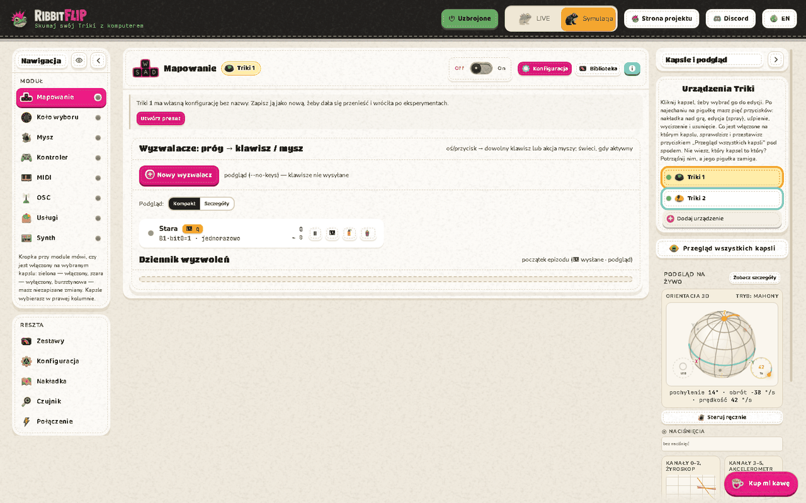

# Pierwsze kroki

← [README](../../README.md) · [English](../en/getting-started.md)

## Czego potrzebujesz

- **Komputer z Windows 10 albo 11 (64-bitowy) i Bluetooth 4.0 lub nowszym (Bluetooth LE).** Bluetooth musi być włączony.
- **Kapsel „Triki".** Jeśli chcesz tylko spróbować, nie potrzebujesz nawet kapsla: aplikacja ma
  symulację, czyli tryb, w którym ruch kapsla jest udawany (opis niżej).
- *Opcjonalnie:* [**ViGEmBus**](https://github.com/nefarius/ViGEmBus/releases), darmowy sterownik,
  dzięki któremu kapsel może udawać pad do gier (kontroler Xbox 360 albo DualShock 4). Instalujesz
  go raz.
- *Opcjonalnie:* [**loopMIDI**](https://www.tobias-erichsen.de/software/loopmidi.html), darmowy
  program, który pozwala kapslowi sterować programem muzycznym na tym samym komputerze.

## Szybki start

1. **Pobierz aplikację.** Wejdź w [Releases](https://github.com/Mastish/RibbitFlip/releases) i w sekcji **Assets** pobierz plik
   `RibbitFlip.exe`. Przenieś go do osobnego folderu, bo obok niego aplikacja zapisuje Twoje
   ustawienia. Wybierz folder, w którym możesz zapisywać pliki (np. w Dokumentach), a nie `Program Files`.
   Chcesz sprawdzić, czy plik dotarł bez zmian? W **Assets** leży też `SHA256SUMS.txt`, a polecenie
   `certutil -hashfile RibbitFlip.exe SHA256` w wierszu poleceń pokaże sumę, która ma się z nim zgadzać.
2. **Uruchom go.** Przy pierwszym uruchomieniu Windows pokaże niebieskie okno SmartScreen, bo plik
   nie ma podpisu cyfrowego. Kliknij **„Więcej informacji"**, a potem **„Uruchom mimo to"**. Skąd
   to okno i czy to bezpieczne, wyjaśnia [FAQ na stronie projektu](https://mastish.github.io/RibbitFlip/#faq).
3. **Znajdź panel.** Aplikacja nie ma zwykłego okna. Pojawia się jako ikona obok zegara, w tak
   zwanym **zasobniku** (Windows 11 może ją schować pod strzałką `˄`), a panel otwiera się sam
   w przeglądarce pod adresem `http://127.0.0.1:8770/`. Ten adres działa tylko na Twoim komputerze.
   Przy pierwszym otwarciu panel zapyta, do czego chcesz używać RibbitFlipa. Wybierz kafel: moduły
   spoza wyboru staną pod **Więcej modułów** na dole listy i dalej działają. Potem panel zaproponuje
   **Przewodnik**, który w sześciu krokach pokaże, gdzie co jest.
4. **Połącz kapsel.** Aplikacja od razu szuka pierwszego kapsla (w panelu widać „Szukam Triki 1…").
   Naciśnij środek kapsla, żeby go obudzić, i trzymaj go blisko komputera. Nie musisz go parować
   w ustawieniach Bluetooth Windows. Po połączeniu w panelu pojawi się kolorowa pigułka z nazwą
   kapsla. Kolejne kapsle dodajesz przyciskiem **Dodaj kapsel** w prawej kolumnie panelu.
5. **Wczytaj gotowy zestaw.** **Zestaw** to zapisany komplet ustawień. **Zestawy** są pierwszą pozycją
   nawigacji po lewej, a czekają tam cztery z plakietką **w aplikacji**:
   - **Media - pokrętło głośności**: kapsel leży płasko i działa jak pokrętło głośności, a kliknięcie
     to start i pauza.
   - **Media - cztery strony**: przechył w prawo i w lewo zmienia utwór, w przód i w tył zmienia
     głośność.
   - **Pad na jeden kapsel (start)**: kapsel udaje pad do gier Xbox, pochylenie to ruch postaci,
     a przycisk kapsla to A.
   - **Pad na dwa kapsle (start)**: dwa kapsle tworzą jeden pad, lewa ręka prowadzi postać, prawa
     kamerę.

   Oba zestawy „Pad…" potrzebują sterownika ViGEmBus.
6. **Włącz moduł.** Wczytanie zestawu niczego nie włącza. Przełącznik **Wył./Wł.** jest w nagłówku
   ekranu modułu, na przykład **Mapowanie**, czyli ekranu z regułami (zestawy „Pad…" potrzebują jeszcze modułu
   **Kontroler**). Główny wyłącznik **Uzbrojone** jest już włączony, więc od tej chwili kapsel
   działa.
7. **Zapamiętaj stop awaryjny: `Alt`+`R`+`F`.** Wyłącza wszystkie moduły naraz, gdyby coś poszło
   nie tak.

**Nie masz kapsla?** Na górnym pasku panelu jest przełącznik **LIVE / Symulacja**. Po przełączeniu
na symulację aplikacja sama uruchamia się ponownie, a kapsel prowadzisz ręcznie myszą (przycisk
„Steruj ręcznie" pod kulą podglądu 3D). Ruch jest udawany, ale klawisze i kliknięcia są prawdziwe,
dlatego w symulacji moduły startują wyłączone.

Aplikację zamykasz z menu ikony w zasobniku (**zakończ**).

## Jak usunąć aplikację

RibbitFlip nie ma instalatora, więc usuwasz go ręcznie:

1. Jeśli w menu ikony w zasobniku zaznaczyłeś **„Uruchamiaj przy starcie Windows"**, odznacz to.
2. Zamknij aplikację: menu ikony w zasobniku, **„Zakończ"**.
3. Usuń folder z `RibbitFlip.exe`. Razem z nim znikną ustawienia (`Settings\`), biblioteka (`Library\`)
   i zgłoszenia (`Zgloszenia\`).
4. Usuń też folder `%LOCALAPPDATA%\RibbitFlip` (wpisz ten adres w pasku Eksploratora), jeśli istnieje.

## Gdy coś nie działa

- **Panel się nie otworzył.** Wpisz w przeglądarce adres `http://127.0.0.1:8770/` albo wybierz
  „otwórz panel" z menu ikony w zasobniku.
- **Ikona zniknęła.** Windows 11 chowa nowe ikony pod strzałką `˄` przy zegarze. Możesz ją
  stamtąd przeciągnąć na pasek.
- **Kapsel się nie łączy.** Sprawdź, czy Bluetooth w komputerze jest włączony. Jeśli kapsel jest
  połączony z telefonem, rozłącz go tam. Trzymaj kapsel blisko komputera i naciśnij jego środek.
- **Kapsel jest połączony, ale nic się nie dzieje.** Sprawdź, czy moduł jest włączony, czy główny
  wyłącznik nie stoi na **Wstrzymane** i czy w module jest jakaś reguła.
- **Pad nie działa w grze.** Zainstaluj sterownik [ViGEmBus](https://github.com/nefarius/ViGEmBus/releases).
- **Antywirus usuwa plik.** To fałszywy alarm, który zdarza się programom naciskającym klawisze.
  Co z tym zrobić, opisuje [FAQ na stronie projektu](https://mastish.github.io/RibbitFlip/#faq).

Nadal nie działa? Napisz na Discordzie na forum **#pomoc** (odnośnik do serwera jest pod przyciskiem
**Pomoc i społeczność** w pasku górnym panelu). Przycisk **„Zgłoś problem"** w stopce
panelu pomoże przygotować zgłoszenie (więcej w części [Społeczność](../../README.md#społeczność)).
