# RibbitBeat: gra dołączona do projektu

← [README](../../README.md) · [English](../en/ribbitbeat.md)

RibbitBeat to gra rytmiczna wbudowana w RibbitFlipa i najszybszy sposób, żeby zobaczyć kapsel „Triki"
w akcji: nic nie ustawiasz, naciskasz przycisk kapsla i śpiewasz razem z żabami. Naklejka w menu gry
mówi „gra demonstracyjna projektu" i po to RibbitBeat powstał, ale gra się w niego normalnie: do ośmiu
graczy, ponad pięćset utworów, nagrody za granie i własne instrumenty. Działa też bez kapsla, myszą, klawiaturą albo padem.

Ta strona opisuje grę taką, jaka jest dziś. RibbitBeat jest na razie w **wersji testowej**: gra działa,
ale wygląd i punktacja mogą się jeszcze zmienić. Uwagi zbieramy na [Discordzie](https://discord.gg/tyv2MjjVdb).

Mówimy to wprost: RibbitBeat to **gra demonstracyjna, stworzona z pomocą AI**. Jej kod i grafiki powstały
z pomocą sztucznej inteligencji, pod kierunkiem autora projektu, a jej jedynym zadaniem jest pokazać, co
potrafi RibbitFlip. W menu gry mówi o tym żółta metka **Stworzona z AI** pod naklejką RibbitFlip: otwiera
okno **O grze**.

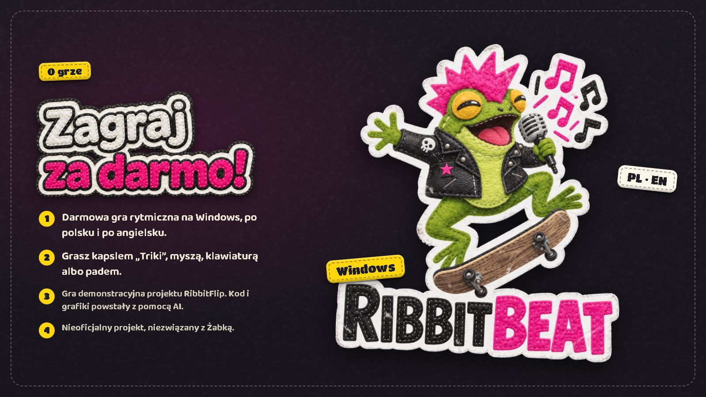

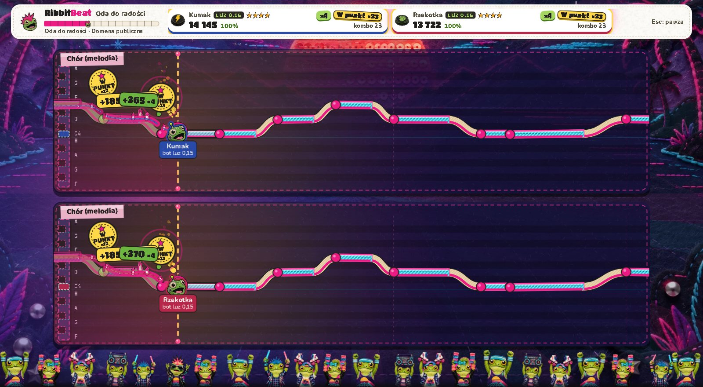

## Jak uruchomić

- **Z panelu RibbitFlipa.** W nawigacji, pod Synthem w grupie **Wypróbuj**, jest przycisk **RibbitBeat**.
  Gra otwiera się w nowej karcie przeglądarki, a kapsle połączone z aplikacją dołączają do niej przyciskiem.
- **Jako osobny program.** `RibbitBeat.exe` z [Releases](https://github.com/Mastish/RibbitFlip/releases)
  uruchamia samą grę, od razu na pełnym ekranie, bez instalowania. Mysz, klawiatura i pad działają od razu;
  kapsle dołączają, gdy na tym samym komputerze działa RibbitFlip albo RibbitFlip Essential. Paczki utworów
  pobrane w aplikacji są od razu w grze i odwrotnie.
- **Bez kapsla.** Mysz, klawisze W/S albo strzałki i pad wystarczą, żeby zagrać i sprawdzić grę, zanim
  kupisz kapsel.
- **Pełny ekran** włącza przycisk w prawym górnym rogu menu albo `F11`. Przełącznik **PL | EN** w stopce
  menu zmienia język całej gry; język wybrany w panelu RibbitFlipa przechodzi do gry sam.

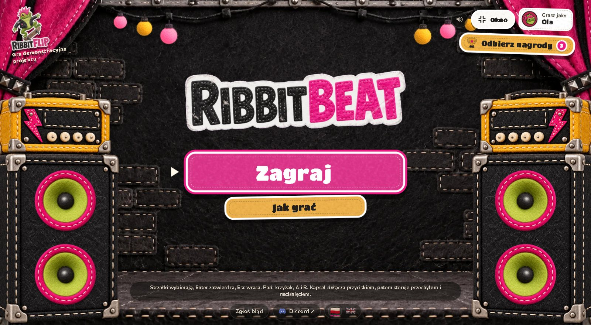

## Jak się gra

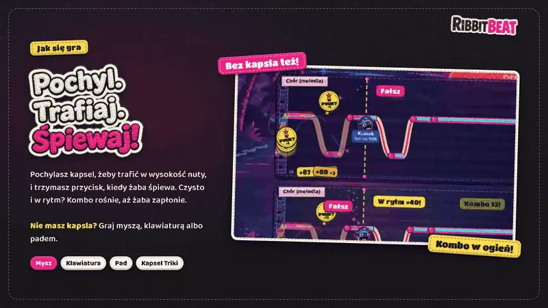

Każda nuta piosenki jedzie po torze w stronę Twojej żaby. Przechylasz kapsel w górę i w dół, żeby trafić
w wysokość nuty, i trzymasz przycisk, gdy żaba ma śpiewać. Nuta ma główkę na początku (zacznij śpiewać)
i pierścień na końcu (przestań); naciśnięcie w rytm wypełnia główkę, a nuta zabarwia się kolorem celności.
Trafienia podbijają kombo, aż ślad za żabą, jej głowa i nuty zaczynają płonąć.

- **W punkt.** Naciśnięcie dokładnie na początku nuty i puszczenie dokładnie na jej końcu (do 100 ms)
  daje premię rosnącą z serią, złoty stempel i licznik w HUD.
- **Świecące frazy.** Każdy utwór ma od 2 do 6 fraz; wszystkie nuty frazy zagrane dobrze dają 50 % premii,
  wszystkie czysto 75 %.
- **Wibrato** na długich nutach robisz każdym sterowaniem: bujasz kapslem na boki, ruszasz myszą w lewo
  i w prawo, stukasz na przemian Q i E (albo . i /) albo prawą gałką pada.
- **Rechot.** Przycisk między nutami to rechot na wysokości przechyłu, dla zabawy, bez punktów i bez kary.
- **Czas na ruch.** Przy dalekim skoku nuta kończy się chwilę wcześniej, żebyś zdążył; suwak od 0 do 150 %
  zmienia ten luz i mnożnik punktów.
- **Dwa tryby nut.** *Klasyczny*: każda nuta osobno, między nutami skok. *Płynny*: dłuższa nuta, która
  dochodzi do sąsiedniej, ślizga się do niej po łuku, a punkty lecą przez cały ślizg.
- **Pauza.** `Esc` zatrzymuje piosenkę; wznowienie liczy 3, 2, 1, `R` zaczyna utwór od nowa, `Q` wychodzi.
- **Jak grać.** Przycisk w menu (i pierwsze **Zagraj**) puszcza samouczek w prawdziwej grze: bot śpiewa,
  a gra zatrzymuje się, żeby wyjaśnić tor, nuty, wibrato, HUD i świecące frazy.

## Kto gra

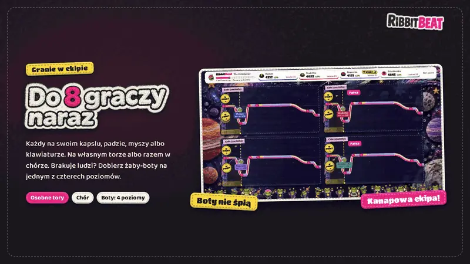

- **Do ośmiu graczy naraz**, każdy na swoim kapslu, padzie, myszy albo klawiaturze. Skład ustawiasz
  w kroku **2 Rozgrywka**: **Dodaj gracza** wybiera sterowanie, a każdy gracz ma imię, kolor, partię,
  instrument i miejsce na liście **Skład**. Skład pamięta się do następnej gry.
- **Kapsel dołącza przyciskiem** na każdym ekranie przed piosenką i od razu prowadzi menu: przechył
  przesuwa zaznaczenie, krótkie naciśnięcie wybiera, przytrzymanie cofa. Kapsel pamięta swój profil.
  W kroku **2 Rozgrywka** kapsel ustawia swoją kartę: przechył w przód i w tył wybiera pole (partia, skin,
  instrument, pomoce, poziom gry), przechył w bok je zmienia, przycisk mówi „gotowe”, a przytrzymanie cofa:
  gotowego do ustawień karty, niegotowego do wyboru piosenki.
- **Boty.** Brakuje ludzi? Dołóż żaby-boty na jednym z czterech poziomów, od Łatwego po Mistrza. W wynikach
  stoją obok ludzi, ale w tablicy wyników są tylko ludzie.
- **Tory.** Przy kilku graczach każdy dostaje własny tor (**Każdy swój**) albo wszyscy śpiewają na jednym
  (**Chór**); układ ekranu (wiersze, kolumny, siatka) dobiera się sam albo ręcznie.
- **Partie.** Każdy utwór ma partie z oceną trudności od 1 do 10 i podglądem. Przed piosenką klawiatura i pad
  ustawiają kartę gracza tak samo jak kapsel: W/S, strzałki góra i dół albo krzyżak wybierają pole (partia, skin,
  instrument, pomoce, poziom gry), A/D, strzałki w bok albo krzyżak w bok je zmieniają, a Spacja, Enter albo A
  mówi „gotowe”.

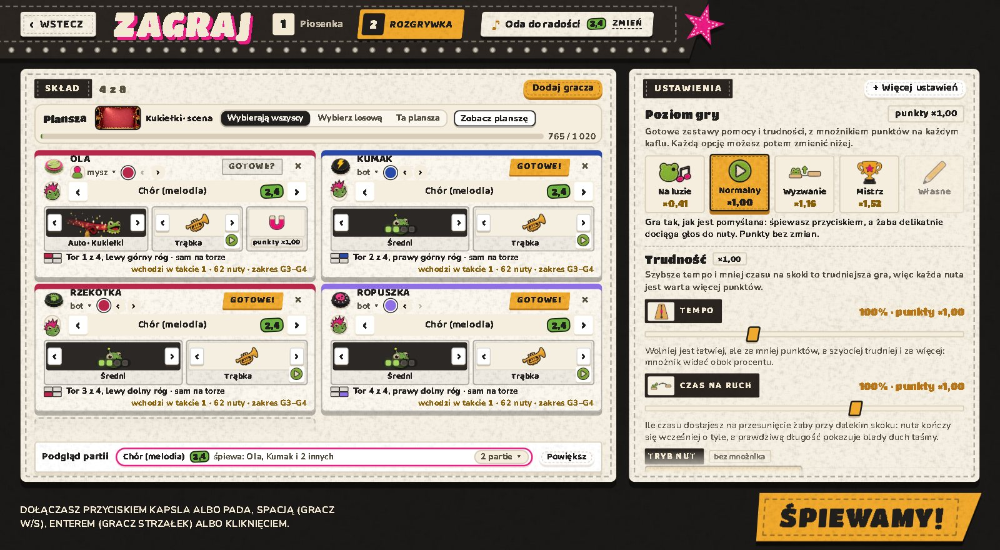

## Ustawienia, poziomy i pomoce

Ustawienia stoją w opisanych grupach: **Poziom gry**, **Trudność**, **Pomoce**, **Sterowanie**, **Ekran
i tory**, **Dźwięk**, **Grafika**. Gotowe zestawy **Na luzie**, **Normalny**, **Wyzwanie** i **Mistrz**
ustawiają pomoce, czas na ruch i tempo jednym kliknięciem; własna mieszanka zostaje jako **Własne**.

Każda pomoc pokazuje swój mnożnik punktów i obniża je mniej więcej o tyle, ile daje, więc nie daje przewagi
w tablicy; procent i gwiazdki liczą się zawsze z samego śpiewu. **Przyciąganie do nut** ma pięć stopni, od
wyłączonego po „Z daleka"; do tego żaba śpiewająca sama, skok do nuty na klawiaturze i cicha podpowiedź
melodii. Kafelek **Pomoce** na karcie gracza daje każdemu jego własne pomoce, zapamiętane w profilu.

Słabszy komputer: **Grafika** *Uproszczona* zamiast *Pełnej*, a gdy klatki nie nadążają, gra sama obniża
grafikę o stopień i to pamięta. Efekty sceny rysuje karta graficzna (WebGL2); bez niej gra zostaje przy
klasycznej grafice.

## Utwory

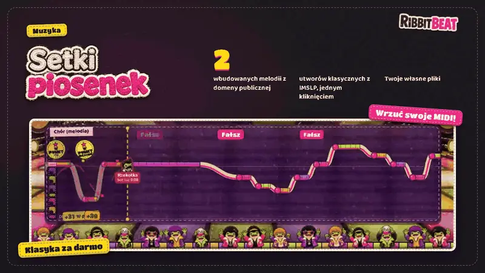

Biblioteka mieszka w **Zagraj**, krok **1 Piosenka**: lista utworów po lewej (zakładki **Wszystkie**,
**Wbudowane**, **Moje**, sortowanie, szukajka, serduszko przypina ulubione), a po prawej wybrany utwór
z podglądem partii, trudnością i tablicą wyników. **Ustawienia piosenki** wysuwają się z prawej krawędzi:
partia do śpiewania, podkład, fragment do ćwiczenia, powtórki i tempo. Przyciski utworu (ulubione, posłuchaj,
ustawienia, tablica) pokazują się w wierszu wybranym albo pod wskaźnikiem. Kapslem: przechył w przód
i w tył wybiera utwór, a trzymany dłużej przewija listę skokami, z literą i miejscem na liście na środku; przechył
w bok chodzi po przyciskach utworu.

Krok wygląda jak scena, nie jak formularz: w tle filcowa scena z menu, utwory to naszywki z kolorowym grzbietem
trudności, a wybrany utwór jest dużą jasną etykietą. Nad listą jest jeden rząd przekładek: źródło utworów, lupa
(szukajka rozwija się po kliknięciu), guzik sortowania i różowa przekładka **Wgraj własny**. Po prawej wisi plakat
wybranej piosenki z pieczątką trudności, a na krawędzi sceny leży ściąga sterowania i przycisk **Dalej**.
Lista działa jak koło w szafie grającej: wybrany utwór stoi zawsze na środku, a naszywki maleją i bledną, im dalej
od środka. Koło wskakuje wiersz po wierszu z tyknięciem, także przy kółku myszy (jeden ząbek to jeden utwór)
i po kliknięciu wiersza, a plakat po prawej zmienia się dopiero wtedy, gdy koło stanie. Z lewej, obok wybranego
utworu, stoi duża litera, a nad nią i pod nią mniejsze litery alfabetu; kliknięcie litery przenosi koło do jej
pierwszego utworu (litery widać przy sortowaniu alfabetycznym). Guzik sortowania ma też **Od najłatwiejszych**:
lista idzie wtedy od najprostszej melodii do najtrudniejszej, a zamiast liter stoją stopnie trudności. Liczba na
naszywce to trudność melodii; gdy utwór ma kilka partii, pod nią jest zakres wszystkich partii, na przykład
**3,1–8,1**, a na plakacie plakietka **Partie 3,1–8,1**. Sześć pasków trudności partii to rzędy lilii wodnych:
pełna lilia to punkt, wyblakła to brak. W podglądzie na plakacie pulsujący przycisk wyboru partii
pokazuje kropkami, ile ścieżek ma utwór (każda w swoim kolorze, bieżąca większa); strzałki po jego bokach
przełączają partię bez rozwijania listy. Strzałki w dolnym wierszu, obok nazwy instrumentu,
zmieniają instrument, którym żaba śpiewa podgląd (to ten sam **Instrument nowego gracza** co w ustawieniach).
Drugie strzałki, z plakietką **MIDI**, zmieniają **Silnik MIDI**, czyli charakter podkładu: **Jeden instrument**
gra wszystko wybranym instrumentem podkładu (jak dotąd), **Jak w pliku** daje każdej ścieżce brzmienie najbliższe
instrumentowi zapisanemu w pliku MIDI (skrzypce grają smyczkami, bas basem i tak dalej; utwory wbudowane takiej
informacji nie mają i grają zwykłym instrumentem podkładu), a zestawy **Zespół**, **Orkiestra**, **Orkiestra dęta**,
**Konsola 8-bit**, **Pozytywka** i **Syntezatory** dają osobne brzmienie basowi, środkowi i górze. Każdy silnik
poza **Jednym instrumentem** gra też perkusję, jeśli plik ją ma. Ten sam wybór
jest w kroku **2 Rozgrywka** w ustawieniach dźwięku i działa także w samej grze.
Krok **2 Rozgrywka** stoi na tej samej scenie:
karty graczy i ustawienia wiszą przed nią, a przycisk **Śpiewamy!** leży na krawędzi sceny.

Przekładka **Wgraj własny** otwiera półkę z paczkami (okładki płyt z liczbą utworów i przyciskiem pobrania)
i wrzutnię na własne pliki. Do wrzutni wybierzesz jeden plik albo wiele naraz, a przycisk **Wybierz cały folder**
wczyta wszystkie pliki MIDI z folderu i jego podfolderów. Folder możesz też upuścić na okno gry. Po imporcie
jeden komunikat podaje, ile utworów doszło, ile już było w bibliotece i ilu nie udało się wczytać.

- **19 wbudowanych melodii** z domeny publicznej, od „Ody do radości" po „The Entertainer".
- **Własne pliki MIDI**: kliknięciem (jeden albo wiele naraz), całym folderem, przeciągnięciem plików albo
  folderu na okno, z adresu albo Ctrl+V. Własny
  utwór usuniesz z biblioteki koszem; jego wyniki wracają, gdy dodasz ten sam plik ponownie.
- **Paczki utworów** z IMSLP: trzy paczki muzyki klasycznej, ok. 530 utworów na licencjach CC0, CC BY
  i CC BY-SA, pobierane jednym kliknięciem z Hugging Face, z paskiem postępu. RibbitFlip nie hostuje żadnej
  muzyki; każdy utwór pokazuje kompozytora, autora pliku MIDI, licencję i źródło.
- Pliki ze zmianami tempa grają w prawdziwym tempie, a pusty, uszkodzony albo perkusyjny plik dostaje
  zrozumiały komunikat zamiast błędu.

## Wyniki i tablica

Po piosence karta wyników rozbija punkty każdego gracza: nuty Czyste, Dobre, Prawie, Fałsz i Pudło,
wibrata, kliknięcia w rytm, „w punkt" i premie za frazy; gwiazdki wbijają się po kolei. **Kopiuj wynik**
daje jedną linię do wklejenia, a **Pochwal się na Discordzie** otwiera kanał serwera.

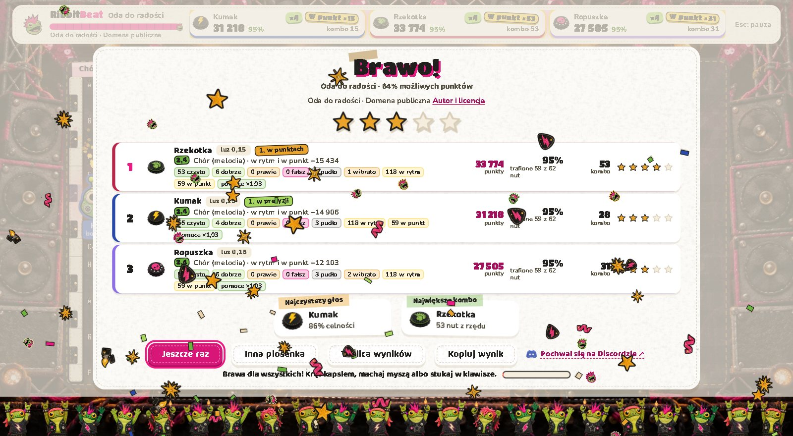

Tablica wyników rozpoznaje plik MIDI po treści (odcisk SHA-256), więc ten sam plik pod inną nazwą ma te
same wyniki, a każda partia, tryb nut i czas na ruch to osobna konkurencja.

## Nagrody: sława, koło i ekipa

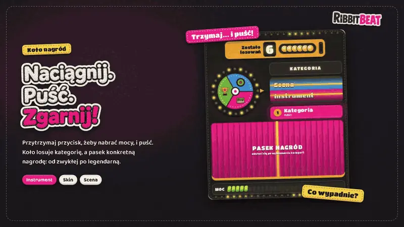

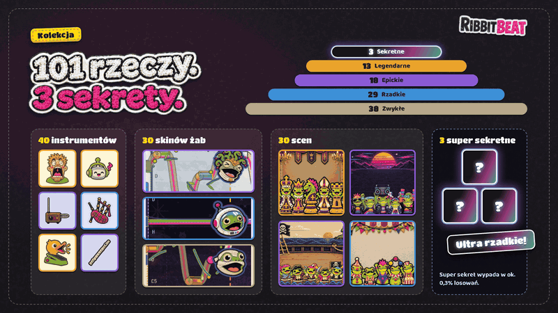

Każdy gracz zbiera **sławę** za piosenki, kombo, nowe utwory i precyzję; pierwsza piosenka dnia liczy się
podwójnie. Cała **ekipa**, czyli wszyscy grający na tym komputerze, zbiera nagrody razem: jeden wspólny
poziom, jedno koło i te same odblokowane rzeczy dla każdego. Przy kilku graczach do wspólnej puli idzie
średnia sława razy mnożnik (×1,25 za dwoje, ×1,4 za troje, ×1,5 od czterech).

- **Koło nagród.** Każdy poziom to losowanie: kapsel wpada do automatu, dźwignia 1 wybiera kategorię
  (instrument, skin albo scena), dźwignia 2 rzecz. Rzadkości idą od zwykłej po legendarną, a czarna
  holograficzna **karta sekretna** ma maleńką szansę w każdym losowaniu i nie zużywa losowania. Przy kilku
  graczach każdy trzyma swój przycisk, a koło rusza, gdy pierwszy puści. Komplet zbiera się w ok. 3 do 5
  godzin grania; **Odbierz nagrody** w menu czeka, gdy losowania zostały z poprzedniej piosenki.
- **41 instrumentów**, każdy z własną filcową ikoną i własną melodyjką po wygraniu: od trąbki, chóru
  i pianina po saksofon, dudy, theremin i legendarny **Krzyk**. Nowa ekipa śpiewa Ribbitem.
- **31 motywów**, czyli plansz (tło, widownia i klawisze jako jedno): od filcu przez 8-bit, Halloween,
  piratów, disco i wyspę tiki po sushi, szachy, złoto, Olimp, prawdziwy staw i teatrzyk lalek. Każdy ma
  własną widownię, iskry, skin żaby i jingiel na koniec piosenki; skin i scena tego samego motywu losują
  się osobno.
- **Plansza przed piosenką.** W pasku **Plansza** w kroku Rozgrywka wybierasz, kto ją wskazuje:
  **Wybierają wszyscy** (okno z kaflami i awatarami wybierających; przy różnych głosach losowanie),
  **Wybierz losową** albo **Ta plansza**.
- **53 osiągnięcia** dają sławę i skróty do motywów. Liczniki postępu i daty zdobycia zobaczysz przez
  **Skin i osiągnięcia** z plakietki konta w menu albo w oknie **Profile**.
- **Studio instrumentów.** Po wygraniu wszystkich instrumentów (albo z karty sekretnej) menu dostaje własny
  ekran do budowania instrumentów: własna fala, oscylatory, filtr, korektor, obwiednia, lampa oscyloskopu,
  pętla testowa na siatce 16 kroków i karta **Próbka**: nagraj mikrofonem albo wczytaj dźwięk z dysku,
  a instrument zaśpiewa Twoim nagraniem na całej klawiaturze. Instrumenty zapiszesz do pliku i wczytasz
  na innym komputerze.

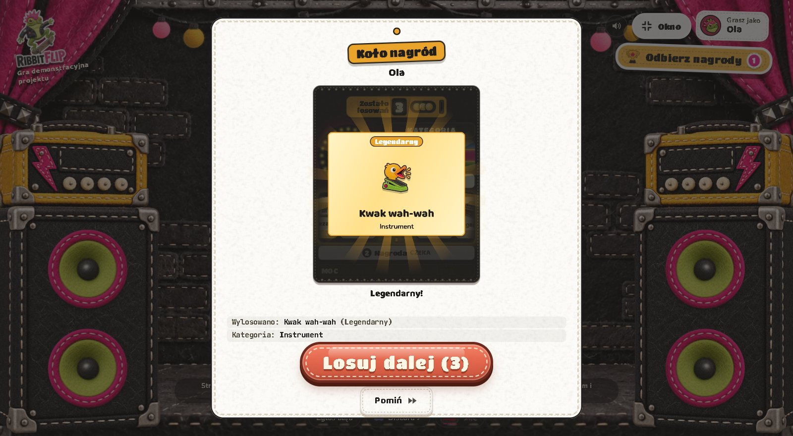

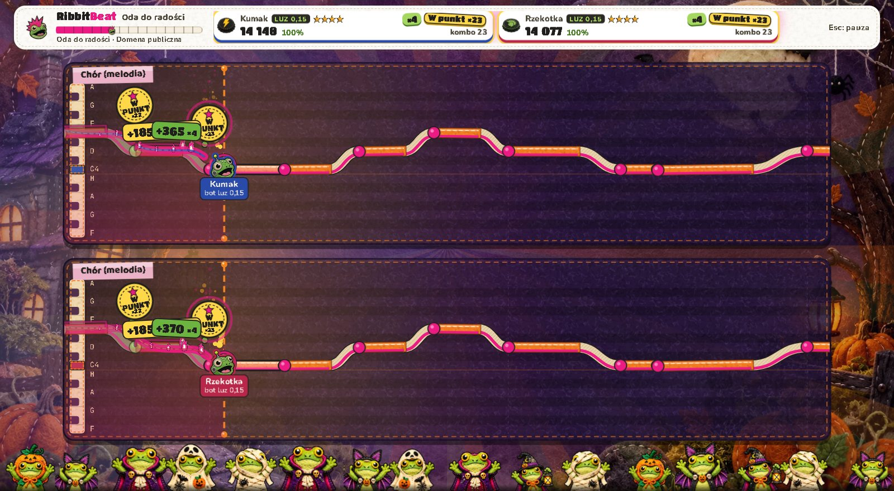

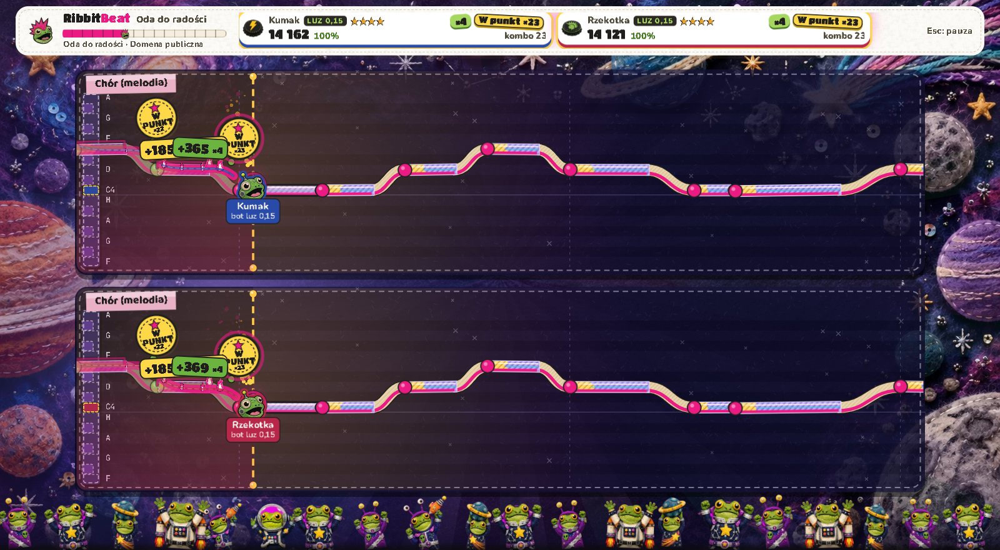

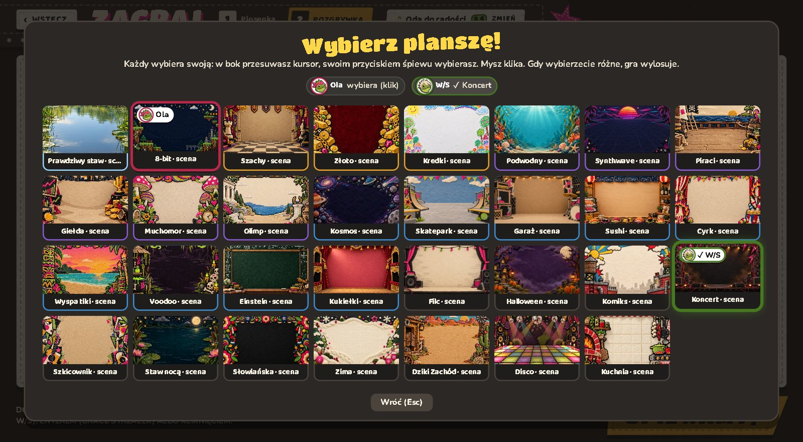

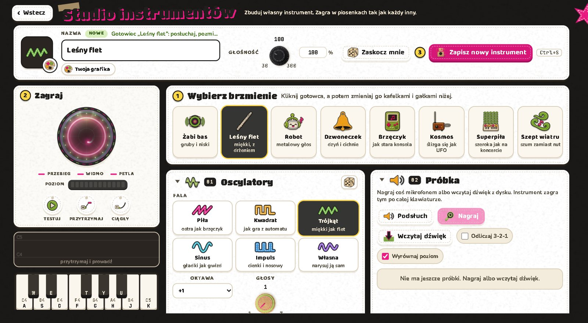

## Konta i profile

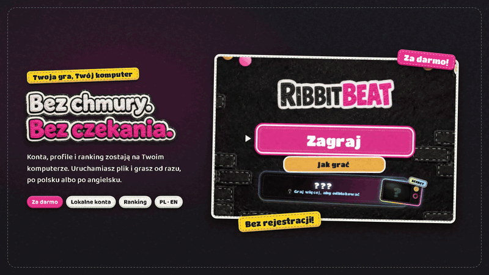

Ekran **Kto gra na tym komputerze?** zakłada konto (imię, ulubiony kolor i jeden z dziesięciu filcowych
awatarów punkowych żab) albo wpuszcza jako gościa; ustawienia pamiętają się na konto. Plakietka **Grasz
jako** w rogu menu otwiera konto i okno **Profile**, gdzie każdego, kto tu grał, można przejrzeć (sława,
motywy, osiągnięcia, gry), przemianować, przypiąć, wyzerować, usunąć, wyeksportować i wczytać na innym
komputerze. Tablica wyników, własne utwory i ulubione zostają w przeglądarce.

## Sterowanie

| | W menu i przed piosenką | W grze |
|---|---|---|
| **Kapsel** | przechył przesuwa zaznaczenie, naciśnięcie wybiera, przytrzymanie cofa | przechył to wysokość nuty, przycisk to śpiew, bujanie na boki to wibrato |
| **Mysz** | kliknięcie | ruch w górę i w dół, przycisk to śpiew, ruch w lewo i w prawo to wibrato |
| **Klawiatura** | strzałki wybierają, Enter zatwierdza, Esc cofa | W/S albo strzałki, Spacja to śpiew, Q i E (albo . i /) wibrato, Shift to ruch precyzyjny, `R` od nowa, `Esc` pauza, `F11` pełny ekran |
| **Pad** | krzyżak wybiera, A zatwierdza, B cofa, Start pauza, Back zamyka okna | gałka to wysokość nuty, przycisk to śpiew, prawa gałka to wibrato |

## Co jeszcze

- **Menu** to filcowa scena koncertowa z głośnikami i lampami, które ruszają się do Dub Riot, autorskiego
  utworu punk-dub; przycisk głośnika w rogu je wycisza. Dźwięki menu mają własny przełącznik i głośność
  w ustawieniach.
- **Discord**: odnośnik w menu i w wynikach prowadzi na serwer projektu.
- **Pełna gra po angielsku**: menu, motywy, osiągnięcia, wbudowane utwory i komunikaty.
- **Prywatność**: gra działa lokalnie, a mikrofon włącza się tylko wtedy, gdy nagrywasz próbkę w Studiu;
  szczegóły w [Bezpieczeństwie i prywatności](prywatnosc.md).

Jak gra siedzi w aplikacji (moduł `gra`, wyłączanie przy starcie, panel) opisuje
[Co potrafi RibbitFlip](funkcje.md). Zmiany z wersji na wersję: [CHANGELOG](../../CHANGELOG.md).
